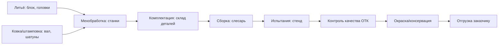

# День 1. Кто такой слесарь механосборочных работ и как устроен цех

> [!abstract] Зачем это вам
> Первый страх новичка: «Я ничего не знаю, и все это увидят». Сегодня вы поймёте, **что именно от вас ждут**, **кто вокруг вас** и **как выглядит путь двигателя**, в котором вы будете одним из звеньев. Когда знаешь карту, ориентироваться проще.

## 🗺 Карта урока

## 🧩 Главное за 1 минуту
- Слесарь механосборочных работ **собирает изделия из готовых деталей**: затягивает, запрессовывает, регулирует, проверяет.
- Работа точная: часто **допуски в сотые доли миллиметра**, поэтому важны **чистота, инструмент и документация**.
- Сборка стоит в середине цепочки: **до** вас деталь отлили и обработали, **после** вас двигатель испытают и отправят заказчику.
- Вы работаете **по технологической карте (ТК)**, а не «по памяти».
- От новичка на старте ждут **не мастерства**, а **аккуратности, дисциплины и желания спрашивать**.

---

## 🔍 1. Что вы будете делать

Профессиональный стандарт «Слесарь механосборочных работ» описывает работу так: **сборка узлов и изделий из готовых деталей**, включая **резьбовые соединения с контролем силы затяжки**, прессовые, штифтовые, шпоночные соединения, подшипниковые узлы, а также **испытание собранных механизмов**. Простыми словами:

| Что делаете | Пример на двигателе |
|---|---|
| Подготовка деталей и инструмента | Протереть, проверить на брак, найти нужный ключ и ТК |
| Установка деталей | Поставить гильзы, вкладыши, поршни, головки |
| Затяжка по моменту | Затянуть шатунные болты динамометрическим ключом |
| Запрессовка/посадка | Напрессовать подшипник, установить втулку |
| Регулировка | Выставить зазоры клапанов, совместить метки |
| Контроль | Измерить зазор, сверить с допуском |
| Передача дальше | Поставить подпись/отметку и передать изделие |

> [!info] Важно
> Вы **не конструктор** и не «сочиняете». Ваша ценность: **делать ровно по документации и замечать отклонения**.

---

## 🔍 2. Путь двигателя по заводу

> [!example] Аналогия
> Это как кухня ресторана. Заготовку нарезали (литьё и мехобработка), повар собирает блюдо (сборка), дегустатор пробует (испытания и контроль), официант несёт (отгрузка). **Ошибка повара портит всё блюдо**, поэтому важно делать по рецепту.

**Что это значит для вас:**
- Деталь, которую вы берёте, **уже прошла обработку**, но не обязательно идеальна. Вы смотрите на брак (царапины, заусенцы, трещины, забоины) и **сообщаете**, а не ставите «как есть».
- После вас идут испытания: если вы недотянули болт, это **вскроется на стенде** (течь, стук, падение давления).

---

## 🔍 3. Кто есть кто на участке

| Кто | Что делает | Когда идти к нему |
|---|---|---|
| **Наставник** | Показывает, учит, отвечает за вас на старте | Всегда, если не уверены |
| **Мастер участка** | Распределяет работу, отвечает за план и качество | Вопросы по заданию, графику, проблемам |
| **Контролёр ОТК** | Проверяет качество, ставит отметки, принимает узлы | Когда нужен замер/приёмка, при сомнении по браку |
| **Технолог** | Разрабатывает технологические карты | Если ТК неясна/противоречит чертежу (через мастера) |
| **Наладчик** | Следит за оборудованием, стендами, инструментом | Сломан или не работает оборудование |
| **Стропальщик / крановщик** | Перемещают тяжёлые детали и двигатели | Подъём любых тяжёлых узлов |
| **Кладовщик / ИРК** | Выдача инструмента и деталей | Нужен инструмент, мерительный или комплектующие |
| **Специалист по охране труда** | Инструктаж, расследование, требования | Любой вопрос безопасности |

> [!tip] Золотое правило
> **Не знаешь, что делать: остановись и спроси наставника или мастера.** На заводе это нормально. Ненормально, когда человек «угадывает», потому что побоялся спросить.

---

## 🔍 4. Разряды и рост

Квалификация слесаря-сборщика обычно выражается **разрядом** (чаще от 2-го до 6-го, зависит от предприятия). Чем выше разряд, тем сложнее изделия и операции:

| Уровень | Что умеет (в общих чертах) |
|---|---|
| Начальный | Простые узлы, подготовка деталей, затяжка по ТК под присмотром |
| Средний | Узлы средней сложности, регулировки, измерения, чтение ТК и чертежей |
| Высокий | Сложные и особо сложные изделия: двигатель целиком, тонкие регулировки, контроль, наставничество |

Разряд повышают после обучения, стажа и аттестации. Спросите на предприятии, **какие условия** и **какая оплата**.

---

## 🛠 На рабочем месте: что вижу, что делаю руками

- Рабочее место: стол/стенд, тележка с деталями, шкаф для инструмента, ТК на стойке.
- **Порядок на месте** — часть работы. Стандарт «5S»: ненужное убрано, нужное лежит на своём месте, место чистое.
- Детали лежат в **таре с маркировкой**; нельзя смешивать одинаковые на вид детали разных групп/партий.
- Много операций **парные/двойные** (две руки, два человека, кран), поэтому важно общаться.

## ⚠ Типичные ошибки новичка

> [!warning] Чего избегать
> 1. **Молчать, когда не понял.** Переспросить дешевле, чем переделывать.
> 2. **Работать «как видел у другого»**, не сверившись с ТК.
> 3. **Пытаться быть быстрым в ущерб качеству.** Скорость придёт сама с опытом.
> 4. **Не записывать.** Заведите блокнот, вечером записывайте, что узнали и что не поняли.
> 5. **Игнорировать порядок и чистоту.** В двигателе мусор убивает подшипники.

## 🔀 У вашего завода/участка может быть иначе
- Разные участки: блоки, головки, коленвалы, общая сборка, испытания, топливная аппаратура.
- Разные формы организации: поточная линия, стенды, бригады.
- Своя нумерация ТК, свои журналы и формы отметок.

## 📷 Фото-задание
Сфотографируйте (если разрешено) и вставьте: **рабочее место**, **стойку с ТК**, **шкаф с инструментом**, **знаки безопасности** на участке. Подпишите, что где.

## ✅ Самопроверка
> [!question]- 1. Где в цепочке «литьё → … → отгрузка» стоит сборка?
> - [ ] Сразу после литья, до мехобработки
> - [x] После мехобработки и комплектации, перед испытаниями и ОТК
> - [ ] После испытаний, перед покраской
> - [ ] В самом конце, после консервации
>
> После мехобработки и комплектации, перед испытаниями и контролем ОТК.

> [!question]- 2. Чем вы руководствуетесь при работе?
> - [x] Технологической картой и чертежом
> - [ ] Опытом соседа по участку
> - [ ] Своей памятью: раз делал, значит помню
> - [ ] Видео из интернета по похожему мотору
>
> Технологической картой (ТК) и чертежом. Не памятью и не «как другие делают».

> [!question]- 3. К кому идти, если нужно измерить зазор «официально»?
> - [ ] К кладовщику
> - [ ] К крановщику
> - [ ] Никуда: записать свой замер на глаз
> - [x] К контролёру ОТК или по порядку, принятому на участке
>
> К контролёру ОТК или по порядку на участке (спросите, как принято).

> [!question]- 4. Что делать, если деталь с царапиной/забоиной?
> - [ ] Зачистить наждачкой и поставить
> - [ ] Поставить, если царапина маленькая
> - [x] Не ставить, показать наставнику, мастеру или ОТК
> - [ ] Самому отнести в металлолом
>
> Не ставить, показать наставнику/мастеру/ОТК, решает ответственный.

> [!question]- 5. Что такое «5S» в двух словах?
> - [ ] Пять видов СИЗ, обязательных в цеху
> - [x] Система порядка: лишнее убрано, всё на своём месте, чисто
> - [ ] Пять разрядов слесаря
> - [ ] Пять стадий сборки двигателя
>
> Система порядка на рабочем месте: убрано лишнее, всё на своём месте, чисто.

> [!question]- 6. Какие виды соединений описаны в профстандарте?
> - [x] Резьбовые, прессовые, шпоночные, штифтовые, подшипниковые узлы
> - [ ] Только резьбовые
> - [ ] Сварные, паяные и клеевые
> - [ ] Только заклёпочные
>
> Резьбовые (с контролем затяжки), прессовые, шпоночные, штифтовые, подшипниковые узлы.

## ❓ 3 вопроса наставнику
1. На каком участке я буду работать и какие операции мне доверят первыми?
2. Какие ТК и документы мне нужно знать в первую очередь?
3. Как принято приглашать ОТК и как фиксируются отметки?

## 📚 Термины
[[Глоссарий/Технологическая карта]] · [[Глоссарий/ОТК]] · [[Глоссарий/Стропальщик]] · [[Глоссарий/5S]]

## ➡ Дальше
[[02_Охрана_труда]]
