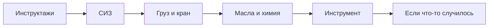
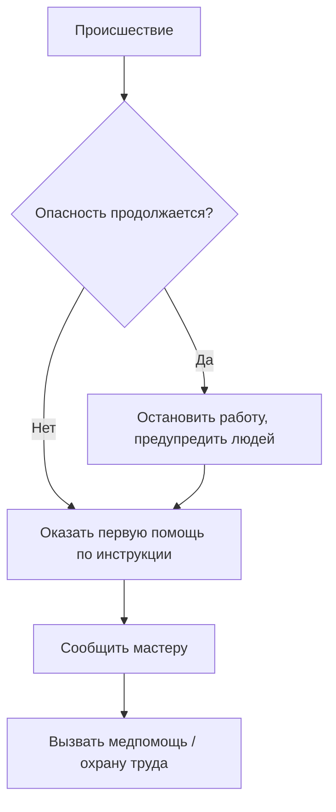

# День 2. Охрана труда: как вернуться домой целым

> [!abstract] Зачем это вам
> Сборка двигателя: **тяжёлые детали, масло на полу, кран над головой, инструмент под давлением**. Большинство травм случается не от «сложных» вещей, а от спешки и привычки. Этот урок короткий, но **самый важный из всех**.

> [!warning] Оговорка
> Здесь общие принципы. **Обязательными являются инструкции вашего предприятия**, которые вам выдадут на вводном и первичном инструктаже. Если они отличаются, **верны они**.

## 🗺 Карта урока

## 🧩 Главное за 1 минуту
- **Без инструктажа к работе не допускают.** Вводный, на рабочем месте, периодические.
- **СИЗ надеваем всегда**, а не «когда кто-то смотрит».
- **Под грузом не стоять.** Никогда. Даже «на секунду».
- Не знаешь безопасный способ, значит **остановись и спроси**.
- Любая травма, даже «царапина», **сообщается мастеру**.
- **«Стоп-работа»**: увидел опасность, имеешь право остановить работу.

---

## 🔍 1. Инструктажи

| Инструктаж | Когда | Кто проводит |
|---|---|---|
| Вводный | В первый день, до допуска к цеху | Специалист по охране труда |
| На рабочем месте (первичный) | До начала самостоятельной работы | Мастер/наставник |
| Повторный | Периодически (по графику предприятия) | Мастер |
| Внеплановый | После случая, изменения процесса | Мастер/охрана труда |

Вы **расписываетесь в журнале**. Подпись означает, что вам объяснили, и вы поняли. Не подписывайте, если не поняли.

---

## 🔍 2. СИЗ (средства индивидуальной защиты)

| СИЗ | От чего защищает | Когда нужно |
|---|---|---|
| **Спецодежда** | Масло, ссадины, зацепы | Всегда в цеху, застёгнуто, рукава не развевающиеся |
| **Защитная обувь (с жёстким носком)** | Падение деталей на ногу | Всегда |
| **Очки** | Стружка, брызги масла/СОЖ, осколки | При рубке, шлифовке, продувке воздухом, работе с жидкостями |
| **Перчатки** | Порезы, масло, химия | Тип по операции (маслостойкие, антипорезные). **Не нужны у вращающихся деталей**, куда может затянуть |
| **Наушники/беруши** | Шум стендов, пневмоинструмента | Рядом с шумным оборудованием |
| **Каска/головной убор** | Удар головой, волосы у станка | При подвесных грузах, где требуют |

> [!warning] Правила, о которых забывают
> - **Нет колец, цепочек, браслетов, свободных шарфов**: они цепляются и затягивают руку.
> - **Длинные волосы убраны.**
> - **Не засовывайте руки** в зону, где что-то может двинуться (стенд, кантователь, подвешенный узел).

---

## 🔍 3. Груз, кран, тележка

Собранный V12-дизель объёмом 20–30 л весит **примерно 1,5–4 тонны** `~пример`: как легковой автомобиль или два. Даже отдельные узлы тяжёлые: коленвал, блок, головка, маховик весят десятки и сотни килограммов. Всё это перемещают только краном или специальной оснасткой.

![[груз_стропы_знаки.svg]]

**Простые правила:**
1. Строповку выполняет **только обученный и допущенный стропальщик**. Вы её не делаете, пока не получили допуск.
2. **Не стоять под грузом** и на пути его движения.
3. Сигналы стропальщика и крановщика **знают все** на участке. Если кричат «Стоп», вы останавливаетесь.
4. Поднимаемые узлы тяжелее 15–20 кг `~пример, проверить норму предприятия` не поднимают в одиночку: тележка, тельфер, второй человек.
5. Поднимать **ногами, не спиной**: присесть, держать спину прямой, не скручиваться.
6. Перед работой осмотрите **стропы, крюки, тару**; видимые повреждения означают «не использовать» и сообщить.

![[сигналы_крановщику.svg]]

---

## 🔍 4. Масла, СОЖ, растворители

| Опасность | Что делать |
|---|---|
| Масло на полу | Сразу убрать/присыпать сорбентом, сообщить. **Скользкий пол это травма** |
| Масло/СОЖ на коже | Мыть, использовать кремы/перчатки по инструкции |
| Растворители и очистители | Только в разрешённых ёмкостях, вдали от огня, с вентиляцией |
| Протирочный материал | В **специальные контейнеры**, не на пол, не в карманы |
| Сжатый воздух | **Никогда не направлять** на людей/на себя; очки при продувке |

---

## 🔍 5. Ручной и механизированный инструмент

- **Исправность перед работой**: нет трещин, не разбита рукоятка, не сорвана «губа» ключа.
- Нужный инструмент для нужной задачи: не «молотком вместо оправки», не «трубой вместо длинной ручки».
- **Пневмоинструмент**: шланг не перегибать, без сильного натяжения, отключать воздух перед заменой насадки.
- **Электроинструмент**: исправный шнур/вилка, заземление, сухие руки, не бросать и не носить за шнур.
- **Динамометрический ключ** не ударный инструмент: не бросать и не использовать как «рычаг».

---

## 🔍 6. Если что-то случилось

- **Любую травму** (даже мелкую) сообщают мастеру: это защищает вас потом.
- **Пожар**: оповестить, эвакуироваться по плану, **не лезть тушить в одиночку**, если не обучены. Узнайте, где **выходы и огнетушители**.
- Узнайте, **где аптечка**, **кто на участке обучен первой помощи**, **телефон охраны труда/медпункта**.

---

## 🛠 На рабочем месте
- Ознакомьтесь с **планом эвакуации** и **знаками** (запрещающие красные, предупреждающие жёлтые, предписывающие синие, эвакуационные зелёные). Как они выглядят, см. нижнюю часть схемы в разделе 3.
- Осмотрите рабочее место до начала: пол, инструмент, оснастка, освещение.
- После работы: **убрать, выключить, отметить**.

## ⚠ Типичные ошибки новичка
> [!warning] Чего избегать
> 1. «Быстренько, без очков/перчаток».
> 2. Стоять под грузом «на секунду».
> 3. Использовать **неисправный инструмент**, чтобы не идти за новым.
> 4. Скрывать мелкую травму, чтобы «не портить статистику».
> 5. **Работать на усталость и спешку**: в конце смены и перед выходными ошибок больше.
> 6. Включать оборудование, которое вам не доверили.

## 🔀 У вашего завода может быть иначе
Свои допуски на стропальные работы, цветовая маркировка зон, правила использования перчаток у станков, нормы по подъёму тяжестей, форма журналов.

## 📷 Фото-задание
Сфотографируйте **план эвакуации**, **аптечку**, **огнетушитель** и **знак зоны подъёма** на вашем участке. Подпишите, где что находится.

## ✅ Самопроверка
> [!question]- 1. Можно ли стоять под подвешенным грузом?
> - [ ] Можно, если груз висит неподвижно
> - [x] Нет, никогда
> - [ ] Можно, если на голове каска
> - [ ] Можно недолго, если крановщик предупреждён
>
> Нет. Никогда.

> [!question]- 2. Кто имеет право строповать груз?
> - [x] Обученный и допущенный стропальщик
> - [ ] Любой, кто стоит ближе к грузу
> - [ ] Любой слесарь со стажем больше года
> - [ ] Крановщик из кабины
>
> Обученный и допущенный стропальщик.

> [!question]- 3. Почему нельзя носить кольцо/браслет на сборке?
> - [ ] Поцарапает деталь, руке ничего не грозит
> - [ ] Мешает надевать перчатки
> - [ ] Только из-за правил внешнего вида
> - [x] Может зацепиться и затянуть или травмировать руку
>
> Может зацепиться за деталь и затянуть руку/повредить палец.

> [!question]- 4. Что делать, если на полу пролито масло?
> - [ ] Обойти и работать дальше
> - [ ] Накрыть ветошью и забыть
> - [x] Убрать или присыпать сорбентом, сообщить мастеру, предупредить других
> - [ ] Дождаться уборки в конце смены
>
> Убрать или присыпать сорбентом, сообщить мастеру, предупредить других.

> [!question]- 5. Можно ли продувать себя сжатым воздухом?
> - [ ] Можно, если давление небольшое
> - [x] Нет: воздух может попасть под кожу, в глаза и уши
> - [ ] Можно, но только через одежду
> - [ ] Можно, если надеты очки
>
> Нет, воздух может проникнуть под кожу и повредить глаза и уши.

> [!question]- 6. Что значит «стоп-работа»?
> - [x] Право и обязанность остановить работу при опасности, пока её не устранят
> - [ ] Сигнал конца смены
> - [ ] Перерыв на обед
> - [ ] Плановая остановка конвейера на уборку
>
> Право и обязанность остановить работу при опасности, пока она не устранена.

## ❓ 3 вопроса наставнику
1. Какие СИЗ обязательны на нашем участке и где их получить?
2. Какие у нас запасные выходы, огнетушители, аптечка?
3. Как здесь принято сообщать о неисправном инструменте или опасном месте?

## 📚 Термины
[[Глоссарий/СИЗ]] · [[Глоссарий/Стропальщик]] · [[Глоссарий/5S]]

## ➡ Дальше
[[03_Чтение_чертежей]]
