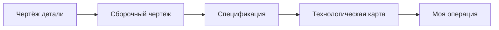
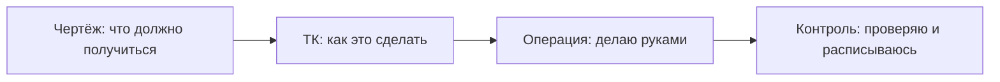

# День 3. Как читать чертёж и технологическую карту

> [!abstract] Зачем это вам
> Чертёж и технологическая карта (ТК) — это **язык цеха**. Ими мастер говорит «что собрать и как». Читать их можно научиться за пару недель, если знать несколько базовых «слов». Сегодня учим самые нужные.

## 🗺 Карта урока

## 🧩 Главное за 1 минуту
- **Чертёж детали**: как деталь выглядит и какие у неё размеры и допуски.
- **Сборочный чертёж**: как детали соединяются в узел.
- **Спецификация**: список деталей узла (номера, количество).
- **Технологическая карта (ТК)**: **пошаговая инструкция** для вашей операции: что, чем, как, с каким контролем.
- Если чертёж и ТК **противоречат**, остановитесь и сообщите мастеру.

---

## 🔍 1. Как устроен чертёж детали

**Сначала главное: почему на чертеже несколько картинок одной детали.** Деталь объёмная, а лист плоский. Поэтому её рисуют так, как она видна **с разных сторон**: спереди, сверху, слева. Каждая картинка называется **вид**. Посмотрите на схему: слева три вида, справа та же деталь «объёмно».

![[три_вида_чертежа.svg]]

> [!tip] Где какой вид лежит на листе (правило ГОСТ)
> **Главный вид** (спереди) рисуют главным, обычно сверху слева. **Вид сверху** кладут **под** ним, **вид слева** **справа** от него. Размеры между видами совпадают: ширина главного вида = ширина вида сверху, высота главного = высота вида слева.

Теперь чертёж настоящей детали (вала). Для круглых деталей часто хватает одного вида: значок Ø говорит, что сечение круглое.

![[чертёж_вала_пример.svg]]

**Что смотреть в первую очередь:**

| Элемент | Что значит | Пример |
|---|---|---|
| **Контур** (толстая линия) | Видимая форма детали | Ступенчатый вал |
| **Осевая линия** (штрихпунктир) | Ось симметрии | Через центр вала |
| **Размерные линии со стрелками** | Размер между этими линиями | Длина 320 мм |
| **Ø (диаметр)** | Знак диаметра | Ø50 |
| **Поле допуска** | Буква+цифра после размера | g6, H7 |
| **Шероховатость Ra** | Насколько гладкая поверхность (мкм) | Ra 0,8 |
| **Резьба M30×2** | Метрическая резьба, диаметр 30, шаг 2 мм | M30×2 |
| **Фаска 2×45°** | Скос кромки | На торце вала |
| **Основная надпись** | Таблица внизу: название, номер, материал, масса, масштаб | «Вал ведущий» |

> [!tip] Как не потеряться
> Читайте в таком порядке: **основная надпись** (что это) → **общий вид** (как выглядит) → **размеры с допусками** (что важно) → **технические требования** (текстом внизу: «острые кромки притупить», «покрытие» и т. п.).

---

## 🔍 2. Сборочный чертёж и спецификация

**Сборочный чертёж** показывает, **как детали стоят друг относительно друга**. На нём:
- детали обозначены **номерами-позициями** (цифры на полках с линиями-выносками),
- есть **разрезы**, показывающие внутреннее устройство,
- указаны **присоединительные и контрольные размеры**.

**Спецификация** — это таблица к сборочному чертежу:

| Поз. | Обозначение | Наименование | Кол. |
|---|---|---|---|
| 1 | ХХХХ.01 | Корпус | 1 |
| 2 | ХХХХ.02 | Крышка | 1 |
| 3 | | Болт М10×40 | 4 |
| 4 | | Шайба 10 | 4 |

> [!example] Как пользоваться
> На чертеже видите цифру **3** → в спецификации находите «Болт М10×40, 4 шт.» → знаете **какой крепёж и сколько**.

![[разрез_и_сборочный_чертёж.svg]]

**Виды и разрезы (очень кратко):**
- **Вид** (спереди, сверху, слева) показывает деталь снаружи.
- **Разрез** условно «разрезает» деталь, чтобы показать внутренность; штриховка показывает материал, который «попал под нож».
- **Сечение** показывает форму в одном месте поперёк.

---

## 🔍 3. Технологическая карта: ваш главный документ

ТК отвечает на вопрос: **«Что мне делать на этой операции?»**

**Типичная структура:**

| Раздел | Что внутри |
|---|---|
| Шапка | Название изделия, номер операции, участок, разряд |
| Оснастка и инструмент | Какие ключи, приспособления, мерительный инструмент использовать |
| Переходы | Пошаговые действия (1. Установить… 2. Затянуть… 3. Проверить…) |
| Режимы/параметры | Момент затяжки, порядок, зазоры, давление, смазка |
| Контроль | Что и чем проверить, допускаемые значения |
| Указания/примечания | Предупреждения, особые условия |
| Отметки | Подписи исполнителя и контролёра |

**Пример (учебный):**

> **Операция 020. Установка шатунных вкладышей и крышки**
> **Оснастка:** динамометрический ключ 20–100 Н·м, пинцет, ёмкость с маслом
> **Переходы:**
> 1. Протереть шейку и вкладыши безворсовой салфеткой.
> 2. Смазать вкладыши моторным маслом.
> 3. Установить вкладыши, совместив фиксирующие усики.
> 4. Установить крышку по метке.
> 5. Затянуть болты в 2 прохода: **~30 Н·м, затем ~90 Н·м `~пример`**.
> 6. Проверить свободное вращение шатуна.
> **Контроль:** ОТК, подпись.

> [!warning] Главное правило ТК
> **ТК выполняется полностью и в заданном порядке.** Пропускать «лишние» переходы нельзя. Если вам кажется, что порядок неудобный, сообщите технологу через мастера. Не меняйте сами.

---

## 🛠 На рабочем месте
- ТК обычно **лежит/висит на рабочем месте** (бумага или экран). Бумажные ТК могут быть в файле/папке.
- На многих операциях есть **образцы/эталоны**: «вот так должно выглядеть». Спросите, где они.
- **Версия** ТК важна: на документе есть номер изменения. Старой версией не пользуются.

## ⚠ Типичные ошибки новичка
> [!warning] Чего избегать
> 1. **Читать ТК «по диагонали».** В ней каждая строка имеет смысл.
> 2. **Путать единицы** (Н·м ≠ кгс·м ≠ мм ≠ мкм).
> 3. **Работать «по памяти»**, потому что «я уже делал так».
> 4. **Не обращать внимания на примечания** («смазать резьбу», «одноразовый болт»).
> 5. **Использовать устаревшую копию.** Всегда сверяйте номер версии.

## 🔀 У вашего завода может быть иначе
Бумажные или электронные ТК, цветные листы, QR-коды, свои формы отметок, нумерация операций.

## 📷 Фото-задание
Найдите на участке **образец ТК** (можно с закрытым названием). Сфотографируйте и **разметьте стрелками** разделы: оснастка, переходы, параметры, контроль, подписи.

## ✅ Самопроверка
> [!question]- 1. Чем сборочный чертёж отличается от чертежа детали?
> - [ ] Выполнен в более крупном масштабе
> - [x] Показывает, как детали соединены в узел, а не форму одной детали
> - [ ] На нём вообще нет размеров
> - [ ] Он нужен только конструктору
>
> Он показывает, как несколько деталей соединены в узел, а не форму одной детали.

> [!question]- 2. Что даёт спецификация?
> - [x] Перечень деталей узла: позиции, обозначения, названия, количество
> - [ ] Список операций и переходов
> - [ ] Моменты затяжки всех болтов
> - [ ] Подписи ОТК о приёмке
>
> Перечень деталей узла: позиции, обозначения, названия, количество.

> [!question]- 3. Что означает «M30×2»?
> - [ ] Болт длиной 30 мм, 2 штуки
> - [ ] Диаметр 2 мм, шаг 30 мм
> - [ ] Резьба 30 мм с двумя заходами
> - [x] Метрическая резьба, диаметр 30 мм, шаг 2 мм
>
> Метрическая резьба диаметром 30 мм с шагом 2 мм.

> [!question]- 4. Что значит «Ra 0,8»?
> - [ ] Допуск размера ±0,8 мм
> - [ ] Радиус скругления 0,8 мм
> - [x] Шероховатость: отклонение профиля 0,8 мкм, поверхность гладкая
> - [ ] Шероховатость 0,8 мм, поверхность грубая
>
> Требование к шероховатости: среднее отклонение профиля 0,8 мкм (поверхность гладкая).

> [!question]- 5. Что делать, если ТК и чертёж противоречат друг другу?
> - [ ] Делать по чертежу: он главнее
> - [x] Остановиться и сообщить мастеру или технологу
> - [ ] Делать по ТК: она новее
> - [ ] Выбрать вариант, который проще
>
> Остановиться и сообщить мастеру/технологу, не решать самому.

> [!question]- 6. Можно ли менять порядок переходов в ТК?
> - [x] Нет, только по согласованию с технологом
> - [ ] Да, если так быстрее
> - [ ] Да, если результат тот же
> - [ ] Да, если мастер разрешил устно мимоходом
>
> Нет. Только по согласованию с технологом.

## ❓ 3 вопроса наставнику
1. Где лежат актуальные ТК и как проверить, что версия свежая?
2. Какие операции у нас самые «опасные» по ошибкам и за что чаще всего возвращают?
3. Есть ли образцы/эталоны, на которые можно ориентироваться?

## 📚 Термины
[[Глоссарий/Технологическая карта]] · [[Глоссарий/Сборочный чертёж]] · [[Глоссарий/Спецификация]] · [[Глоссарий/Шероховатость]] · [[Глоссарий/Допуск]]

## ➡ Дальше
[[04_Допуски_и_посадки]]
