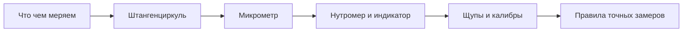
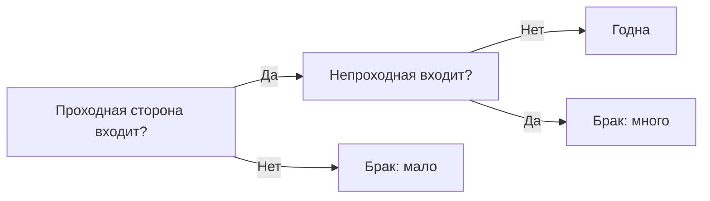

# День 5. Измерительный инструмент: как мерить и не ошибиться

> [!abstract] Зачем это вам
> Вчера вы узнали, что «сотки» важны. Сегодня: **чем и как их измерять**. Хороший сборщик отличается тем, что **не доверяет глазу**, а **доверяет поверенному инструменту** и умеет им правильно пользоваться.

## 🗺 Карта урока

## 🧩 Главное за 1 минуту
- **Штангенциркуль**: быстрый, точность 0,05–0,1 мм (бывает 0,02).
- **Микрометр**: точный, 0,01 мм; для валов, толщин.
- **Нутромер/индикатор**: для отверстий и биения.
- **Щуп**: набор пластин для зазоров.
- **Калибры («проходной/непроходной»)**: быстро проверить, годна деталь или нет.
- Инструмент должен быть **поверен** (есть бирка/клеймо с датой).
- **Температура и чистота** влияют на результат.

---

## 🔍 1. Что чем меряем

| Что нужно | Чем | Точность (типично) |
|---|---|---|
| Длина, наружный диаметр (грубо) | Штангенциркуль | 0,05–0,1 мм |
| Наружный диаметр точно | **Микрометр** | 0,01 мм |
| Диаметр отверстия | **Нутромер** (индикаторный) | 0,01 мм |
| Биение, неплоскостность | **Индикатор часового типа** на стойке | 0,01 мм |
| Малый зазор (клапан, кольцо) | **Набор щупов** | 0,02–1 мм |
| «Годен/не годен» по размеру | **Калибр-пробка / калибр-скоба** | по допуску |
| Глубина | Глубиномер штангенциркуля / микрометрический | 0,05–0,01 мм |

---

## 🔍 2. Штангенциркуль

![[штангенциркуль.svg]]

**Как пользоваться:**
1. Протрите губки и деталь. Сведите губки: **нуль нониуса совпадает с нулём штанги**.
2. Приложите деталь губками **без перекоса и без нажима**.
3. Зафиксируйте винт (если нужно) и читайте.

**Как читать (на примере точности 0,1 мм):**
1. **Целые мм**: смотрите, сколько целых делений штанги прошёл «нуль» нониуса. Допустим, **24 мм**.
2. **Доли мм**: найдите **черту нониуса, совпадающую** с чертой штанги. Допустим, шестая → **0,6 мм**.
3. Итог: **24 + 0,6 = 24,6 мм**.

> [!tip] Для точности 0,05 и 0,02 мм
> Принцип тот же: цена одного деления нониуса другая (0,05 или 0,02). Цифра цены нанесена на нониус.

**Типичные ошибки:** перекос губок, усилие, замеры без обнуления, чтение «под углом».

---

## 🔍 3. Микрометр (0,01 мм)

**Принцип:** винт с шагом 0,5 мм. За оборот барабана вал смещается на 0,5 мм. Барабан имеет 50 делений, значит каждое = 0,01 мм.

![[микрометр.svg]]

**Как читать:**
1. Смотрим на **стебель**: читаем целые мм и, если видна, **половинку** (0,5 мм). Половинки нанесены **под** продольной линией, целые мм **над** ней. Пропустить половинку — самая частая ошибка: ответ получится на 0,5 мм меньше.
2. Смотрим на **барабан**: какое деление совпало с продольной линией.
3. Складываем.

> [!example] Пример
> Стебель показывает **12,5 мм** (видна и половинка).
> Барабан: деление **23** → 0,23 мм.
> **Результат: 12,5 + 0,23 = 12,73 мм.**

**Правила:**
- Подводите **только трещоткой** (она создаёт постоянное усилие). Не «закручивайте» барабаном.
- Перед работой проверить **нуль** (сомкнуть измерительные поверхности).
- Хранить с небольшим зазором между пятками, без усилия.

---

## 🔍 4. Нутромер, индикатор, щупы, калибры

![[индикатор_нутромер_щуп.svg]]

**Нутромер индикаторный** — для **отверстий** (гильза, постель, втулка). Устанавливают на эталон (кольцо/микрометр), затем качают в отверстии и читают **минимум показания** в поперечной плоскости.

**Индикатор часового типа** — измеряет **отклонения**: биение вала, плоскостность, смещение. Закрепляется на **стойке/магнитной стойке**. **Не** показывает размер, только «на сколько отклонилось».

**Щупы** — набор тонких пластин с размерами (0,05; 0,10; …). Вставляют **в зазор**; нужная толщина должна **проходить с лёгким усилием**. Пример: зазор клапана.

**Калибры:**
- **Пробка** — для отверстий: проходная сторона должна входить, непроходная нет.
- **Скоба** — для валов: проходная надевается, непроходная нет.
- **Резьбовые калибры** — проверка резьбы.

---

## 🔍 5. Правила точных замеров

| Правило | Почему |
|---|---|
| **Чистая деталь и инструмент** | Грязь даёт погрешность в сотки |
| **Одинаковая температура** | Нагретая деталь «больше» |
| **Нулевая проверка** | Сбитый нуль = все замеры неверны |
| **Нет усилия** (трещотка) | Нажим деформирует деталь и инструмент |
| **Несколько замеров** в разных сечениях и плоскостях | Деталь может быть овальной/конусной |
| **Поверенный инструмент** | Бирка/клеймо с датой, просрочка = нельзя |
| **Бережное хранение** | Удар разбивает точность навсегда |

> [!warning] Не бросайте и не стучите
> Упавший микрометр или нутромер **считается неисправным** до повторной поверки. Сообщите.

---

## 🛠 На рабочем месте
- Мерительный инструмент обычно **выдаётся под учёт** (ИРК/кладовая), с **биркой поверки**.
- Рядом с рабочим местом должны быть **эталоны** (кольца, меры, установочные приспособления).
- Результаты замеров часто **заносят в журнал/карту**.

## ⚠ Типичные ошибки новичка
> [!warning] Чего избегать
> 1. **Мерить грязной деталью** или прямо после обработки (тёплой).
> 2. **Давить на микрометр** без трещотки.
> 3. **Читать со смещением глаза** (параллакс).
> 4. **Не проверить нуль.**
> 5. **Пользоваться просроченным инструментом.**
> 6. **Один замер на деталь**, хотя ТК требует несколько сечений.

## 🔀 У вашего завода может быть иначе
Цифровые штангенциркули и микрометры с выводом в систему, автоматические калибры, измерения на стойках и КИМ (координатно-измерительных машинах).

## 📷 Фото-задание
Сфотографируйте **свой штангенциркуль/микрометр и бирку поверки**. Потренируйтесь: измерьте **толщину листа бумаги** и **диаметр монеты** (разные инструменты), запишите.

## ✅ Самопроверка
> [!question]- 1. Каким инструментом меряют отверстие?
> - [ ] Гладким микрометром
> - [x] Индикаторным нутромером (грубо — штангенциркулем)
> - [ ] Набором щупов
> - [ ] Металлической линейкой
>
> Нутромером (индикаторным), штангенциркулем грубо.

> [!question]- 2. Чему равно деление барабана микрометра?
> - [x] 0,01 мм
> - [ ] 0,1 мм
> - [ ] 0,05 мм
> - [ ] 0,001 мм
>
> 0,01 мм.

> [!question]- 3. Прочтите: стебель 18,5 мм, барабан 07.
> - [ ] 18,507 мм
> - [ ] 18,75 мм
> - [ ] 25,5 мм
> - [x] 18,57 мм
>
> 18,5 + 0,07 = 18,57 мм.

> [!question]- 4. Зачем нужна трещотка?
> - [ ] Чтобы быстрее крутить барабан
> - [ ] Чтобы зафиксировать размер
> - [x] Чтобы усилие измерения было одинаковым и малым
> - [ ] Чтобы обнулить микрометр
>
> Чтобы усилие измерения было одинаковым и малым, без деформации.

> [!question]- 5. Что делать с просроченным инструментом?
> - [ ] Пользоваться, пока показывает
> - [x] Не использовать, сдать на поверку, сообщить
> - [ ] Проверить на глаз и пользоваться
> - [ ] Самому подкрутить ноль
>
> Не использовать, сдать на поверку, сообщить.

> [!question]- 6. Чем калибр отличается от штангенциркуля?
> - [x] Не показывает размер, только отвечает «годен / не годен»
> - [ ] Он точнее и показывает микроны
> - [ ] Меряет только глубину
> - [ ] Ничем, это другое название
>
> Калибр не показывает размер, а только отвечает «годен/не годен».

## ❓ 3 вопроса наставнику
1. Какой инструмент выдаётся мне лично и как его получать и сдавать?
2. Как у нас оформляются результаты замеров?
3. Где проверить, что инструмент поверен?

## 📚 Термины
[[Глоссарий/Штангенциркуль]] · [[Глоссарий/Микрометр]] · [[Глоссарий/Нутромер]] · [[Глоссарий/Индикатор часового типа]] · [[Глоссарий/Щуп]] · [[Глоссарий/Калибр]] · [[Глоссарий/Поверка]]

## ➡ Дальше
[[06_Слесарный_инструмент_и_крепёж]]
