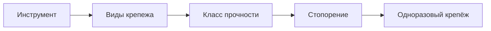

# День 6. Слесарный инструмент и крепёж

> [!abstract] Зачем это вам
> Сборка двигателя — это в основном **соединение деталей болтами и шпильками**. Вы должны знать, **что за крепёж** перед вами, **каким инструментом его закручивать** и **почему некоторые болты нельзя использовать второй раз**.

## 🗺 Карта урока

## 🧩 Главное за 1 минуту
- **Накидной ключ и головка** (торцевой) надёжнее рожкового: охватывают гайку со всех сторон.
- **Болт** с головкой, **шпилька** без головки (с двух сторон резьба), **гайка** на шпильку.
- **Класс прочности** написан на головке: например, **10.9**. Чем выше, тем прочнее. Заменять на «похожий» нельзя.
- **Стопорение** не даёт крепежу самоотвинтиться (шплинт, шайбы, контргайки, фиксаторы резьбы).
- Некоторый крепёж **одноразовый**, это обязательно указано в ТК.

---

## 🔍 1. Основной слесарный инструмент

![[ключи_и_инструмент.svg]]

| Инструмент | Для чего | Подсказка |
|---|---|---|
| **Торцевая головка + трещотка/вороток** | Основной инструмент для гаек и болтов | Выбирайте **точный размер**, шестигранник (6 граней) надёжнее 12-гранника |
| **Накидной ключ** | Затяжка там, где нет места для головки | Не «вытягивайте» трубой |
| **Рожковый ключ** | Быстрая работа без высокого момента | Не для окончательной затяжки |
| **Динамометрический ключ** | Затяжка с контролем момента | См. день 7 |
| **Шестигранники, TORX** | Винты с внутренним профилем | Профиль должен совпасть без люфта |
| **Отвёртки** | Шлицевые/крестовые | Используйте нужный размер, иначе сорвёте шлиц |
| **Съёмники** | Снять подшипник, шестерню, втулку | Не бить, не нагревать без ТК |
| **Оправки** | Запрессовка/выпрессовка | Только из мягкого/нужного материала, диаметр по детали |
| **Молотки (медный, текстолитовый, резиновый)** | Лёгкая посадка без повреждения | Стальным молотком по ответственным деталям не бить |
| **Плоскогубцы, кусачки, пинцет** | Шплинты, пружины, проволока | |
| **Пневматический/электрический гайковёрт** | Быстрая затяжка по программе | Только для операций, указанных в ТК |

> [!warning] Ключ должен подходить
> **Неподходящий ключ срывает грани** болта и гайки. Это брак и лишняя работа. Правильно посаженный ключ без люфта.

---

## 🔍 2. Виды крепежа

![[болт_строение.svg]]

| Тип | Описание | Где |
|---|---|---|
| **Болт** | Головка + стержень с резьбой; **вкручивается** в корпус или идёт в паре с гайкой | Крышки, фланцы, кронштейны |
| **Шпилька** | Стержень с резьбой с двух концов; один конец в корпус, на другой гайка | Головки блока, коллекторы |
| **Гайка** | Навинчивается на шпильку/болт | Повсеместно |
| **Винт** | Мелкий болт, часто под отвёртку | Крышки, датчики |
| **Шайба** | Распределяет нагрузку, защищает поверхность | Под гайку/головку |
| **Пружинная шайба (гровер)** | Стопорит от самоотвинчивания | В ответственных узлах двигателя встречается редко; ставят только там, где указано в ТК |

**Размер резьбы** записывается так: **М12×1,5** = метрическая, диаметр 12 мм, **шаг 1,5 мм**. Если шаг не указан, значит **крупный** (стандартный). Мелкий шаг (М12×1,25) встречается в двигателях часто. **Не перепутайте**: резьба не пойдёт и сорвётся.

**Размер «под ключ» (S)** — расстояние между гранями головки; именно он определяет, какой ключ нужен (например, 17, 19, 22).

---

## 🔍 3. Класс прочности

На головке болта (и гайки) стоит маркировка: **8.8, 10.9, 12.9** и т. д.

| Маркировка | Что означает (примерно) | Где применяют (общий смысл) |
|---|---|---|
| **8.8** | Прочность на разрыв ~800 МПа | Некритичные соединения |
| **10.9** | ~1000 МПа, предел текучести 0,9 от этого | Ответственные соединения |
| **12.9** | ~1200 МПа | Самые нагруженные |

**Как расшифровать «10.9»:** 10 × 100 = **1000 МПа** (прочность на разрыв), 10 × 9 × 10 = **900 МПа** (предел текучести).

> [!warning] Нельзя
> - **Ставить болт другого класса** «потому что похож».
> - **Ставить другой длины**, чем в ТК: слишком короткий не затянется, слишком длинный упрётся в дно отверстия.
> - **Смешивать** болты разных типов в одной таре.

---

## 🔍 4. Стопорение: как крепёж «не откручивается»

Двигатель вибрирует и греется. Поэтому крепёж **фиксируют**:

![[стопорение.svg]]

| Способ | Как работает | Особенность |
|---|---|---|
| **Шплинт** | Проволочная «чека» в отверстии корончатой гайки | Всегда **новый**, концы разводят/загибают |
| **Контргайка** | Вторая гайка прижимается к первой | Моменты задаёт ТК |
| **Стопорная шайба с усиком** | Усик загибают на грань гайки/головки | Новая шайба, загиб без трещин |
| **Проволока (контровка)** | Проволока связывает головки болтов | Закручивают в сторону затяжки |
| **Фиксатор резьбы (анаэробный состав)** | Состав затвердевает в резьбе | Только указанной марки, на чистую обезжиренную резьбу |
| **Самоконтрящаяся гайка** | Вставка (нейлон/деформированная резьба) | Обычно **одноразовая** |
| **Пружинная шайба** | Создаёт упругость | Не заменяет затяжку по моменту |

---

## 🔍 5. Одноразовый крепёж

Некоторые болты **нельзя использовать повторно**, потому что при затяжке они **растягиваются в зоне упругости** и теряют свойства:
- **Болты, затянутые на угол** (с доворотом) или «в пластику».
- **Шплинты, самоконтрящиеся гайки, стопорные шайбы**, пломбы.
- **Болты с повреждённой резьбой или головкой.**

> [!warning] Золотое правило
> **ТК говорит «заменить», значит заменяем**. Не «потому что проверил, вроде нормальный». Скрытые микротрещины невидимы.

---

## 🛠 На рабочем месте
- Крепёж лежит в **таре с маркировкой**: тип, размер, класс прочности, номер.
- Перед затяжкой резьбу **осматривают**: нет ли заусенцев, коррозии, остатков фиксатора.
- Резьбу в корпусе **продувают** и протирают, чтобы не осталось масла (если ТК требует «сухую» резьбу) или смазывают (если требуется).

## ⚠ Типичные ошибки новичка
> [!warning] Чего избегать
> 1. **Подбирать ключ «примерно».**
> 2. **Использовать болт «на глаз» другой длины.**
> 3. **Затягивать, не очистив и не осмотрев резьбу.**
> 4. **Применять старый шплинт или одноразовую гайку.**
> 5. **Смешивать крепёж разных типов.**
> 6. **Ударять по ключу** молотком, если это не ударный инструмент.

## 🔀 У вашего завода может быть иначе
Крепёж с цветными метками, ТК с кодами крепежа, комплектующие в упаковках «на узел», автоматические гайковёрты.

## 📷 Фото-задание
Найдите **болт с маркировкой класса прочности**, сфотографируйте головку. Найдите **шплинт**, **стопорную шайбу**, **самоконтрящуюся гайку** и подпишите.

## ✅ Самопроверка
> [!question]- 1. Чем шпилька отличается от болта?
> У шпильки нет головки, резьба с двух концов.

> [!question]- 2. Что означает «М12×1,5»?
> Метрическая резьба, диаметр 12 мм, шаг 1,5 мм.

> [!question]- 3. Что означает маркировка 10.9?
> Прочность на разрыв ~1000 МПа, предел текучести 900 МПа.

> [!question]- 4. Можно ли использовать шплинт повторно?
> Нет, всегда новый.

> [!question]- 5. Почему шестигранная головка лучше 12-гранной для сборки?
> Меньше шансов сорвать грани, выше надёжность при большом моменте.

> [!question]- 6. Что делать, если болт нужного класса не нашли?
> Не заменять на похожий, обратиться к мастеру/на склад.

## ❓ 3 вопроса наставнику
1. Какой крепёж у нас считается одноразовым и где это указано?
2. Как у нас хранится и маркируется крепёж?
3. Какие фиксаторы резьбы мы применяем и когда?

## 📚 Термины
[[Глоссарий/Класс прочности]] · [[Глоссарий/Шпилька]] · [[Глоссарий/Шплинт]] · [[Глоссарий/Контргайка]] · [[Глоссарий/Фиксатор резьбы]] · [[Глоссарий/Динамометрический ключ]]

## ➡ Дальше
[[07_Резьбовые_соединения_и_момент]]
