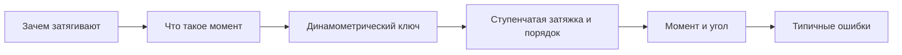
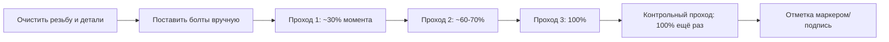

# День 7. Резьбовые соединения и момент затяжки

> [!abstract] Зачем это вам
> **Это главный навык сборщика.** Именно затяжка по моменту стоит за словами профстандарта «резьбовые соединения с контролем силы затяжки». Недотянутый болт шатуна или головки в дизеле — это **поломка двигателя**. Перетянутый — тоже. Сегодня вы узнаете, **что такое момент**, **как им пользоваться** и **почему порядок важен**.

## 🗺 Карта урока

## 🧩 Главное за 1 минуту
- Болт работает как **пружина**: при затяжке он **растягивается** и прижимает детали. Это **усилие затяжки**.
- **Момент затяжки** (Н·м) — это **«скручивающее усилие» на ключе**, по нему мы косвенно контролируем усилие затяжки.
- Затягиваем **динамометрическим ключом**, **плавно**, **ступенями** и **в нужном порядке**.
- На момент влияют **смазка, чистота резьбы, состояние болта**. Условия указаны в ТК.
- Некоторые соединения затягивают **моментом + доворотом на угол**.
- **Не помнишь число — открой ТК.**

---

## 🔍 1. Зачем болт затягивают

Представьте **резинку**, которой вы стягиваете два предмета. Растянутая резинка прижимает их. Болт — это очень жёсткая «резинка»: при затяжке он **чуть удлиняется** (на доли миллиметра) и прижимает детали **усилием затяжки**.

| Недотяг | Перетяг |
|---|---|
| Соединение «разойдётся» под нагрузкой | Болт растянется за предел и **сломается** или потеряет упругость |
| Течь (масло, газ, вода) | Сорванная резьба, повреждённая деталь |
| Вибрация откручивает | Деформация корпуса, прокладки |
| Поломка узла | Лопнувшая головка |

**Правильная затяжка** это **«в золотой серединке»**: достаточно сильно, но не слишком.

---

## 🔍 2. Что такое момент и почему его нельзя «чувствовать»

**Момент** = сила × плечо. Измеряется в **Н·м** (ньютон-метр). Старые документы могут давать **кгс·м** (1 кгс·м ≈ 9,81 Н·м).

> [!example] Простой пример
> 50 Н·м — это как давить на ключ длиной 0,5 м с усилием 100 Н (~10 кг).

**Важный факт:** при затяжке **до 90% момента уходит на преодоление трения** (под головкой и в резьбе) и лишь **около 10%** превращается в полезное усилие растяжения `~пример`. Поэтому:
- **Грязная/ржавая резьба** → больше трения → при том же моменте болт **недотянут**.
- **Смазанная резьба** → меньше трения → при том же моменте болт **перетянут**.
- Поэтому в ТК указывают **состояние резьбы**: «сухая», «слегка смазана маслом», «с фиксатором».

> [!warning] Правило
> **Состояние резьбы должно соответствовать ТК.** Не смазывайте, если не сказано. Не вытирайте, если сказано «смазать».

---

## 🔍 3. Динамометрический ключ

**Динамометрический ключ** позволяет затянуть болт до заданного момента.

![[динамометрический_ключ.svg]]

| Тип | Как работает | Особенности |
|---|---|---|
| **Щелчковый** | При достижении момента «щёлкает» и проскальзывает | Самый распространённый. Нужна установка по шкале |
| **Стрелочный** | Стрелка показывает текущий момент | Читать нужно прямо, без перекоса |
| **Электронный** | Дисплей, сигналы, память | Точный, фиксирует значения |
| **Гайковёрт с контролем** | Пневмо/электро по программе | Только для операций из ТК |

**Правила работы с щелчковым ключом:**
1. Подберите **диапазон** (момент не должен быть в самом низу или верху шкалы).
2. **Установите момент** (разблокируйте стопор, выставьте, заблокируйте).
3. Установите головку, **плавно** тяните за рукоять **в конце ручки** (в отмеченном месте).
4. При **щелчке** сразу прекращайте. **Не тяните дальше.**
5. После работы **ослабьте шкалу до минимума**, чтобы пружина не «уставала» (только для щелчковых).

> [!warning] Нельзя
> - Использовать динамометрический ключ **для откручивания**.
> - **Надевать трубу** на ключ.
> - **Бросать, ударять.**
> - Работать **просроченным** по поверке ключом.
> - Тянуть **рывком**: щелчок «пропускается».

---

## 🔍 4. Порядок затяжки и ступени

![[порядок_затяжки.svg]]

**Почему порядок важен:** если затянуть один болт полностью, крышка **перекосится**, соседние окажутся «висящими». Поэтому затягивают **равномерно**: от центра наружу или «крест-накрест».

**Почему ступенчато:** деталь и прокладка **садятся постепенно**. За один проход получится неравномерное прижатие.

> [!example] Пример
> Требуется **100 Н·м** (`~пример`). Проход 1: 30 Н·м по порядку. Проход 2: 70 Н·м. Проход 3: 100 Н·м. Контрольный проход: 100 Н·м по порядку без доворота, проверка, что все «щёлкают».

> [!danger] Контрольный проход НЕ делают у болтов «момент + угол»
> Если болт затягивается с доворотом на угол (раздел 5), после доворота его **нельзя «проверить» ещё раз ключом или довернуть**: он уже растянут до нужной величины, лишний доворот перетянет его. Контроль таких болтов делают только так, как написано в ТК (обычно по метке-риске угла).

**Контроль:** после затяжки многие операции требуют **маркер-отметку** (риска на болте/гайке/детали), которая показывает, что болт затянут.

---

## 🔍 5. Момент и доворот на угол

Для особо ответственных соединений (шатунные болты, головки) часто применяют **затяжку моментом + доворот на угол**:

1. Затянуть **предварительно** моментом (например, 30 Н·м) `~пример`.
2. Затем **довернуть на заданный угол** (например, 90°) с помощью угловой шкалы или приспособления.

**Зачем?** Угол **точнее** связан с растяжением болта, чем момент, не так зависит от трения.

> [!warning] Такие болты обычно одноразовые
> Растяжение уходит в зону, где болт **теряет упругость**. ТК скажет: «заменить».

---

## 🔍 6. Проблемы с резьбой: что может пойти не так

| Проблема | Как проявляется | Что делать |
|---|---|---|
| Сорванная резьба | Болт «прокручивается» без затяжки | Остановиться, сообщить, не «затягивать посильнее» |
| Заедание резьбы (задир) | Идёт туго, «скрипит» | Не использовать силу, очистить, проверить деталь |
| «Болт дошёл до дна» | Не затягивается, упирается | Проверить длину болта и глубину отверстия |
| Отсутствие щелчка | Ключ не щёлкает | Проверить настройку и поверку, не «затягивать на глаз» |
| Момент в ТК кажется странным (слишком мал или велик для такого болта) | Возможна опечатка или старая версия ТК | Не затягивать «как кажется правильным»: сообщить мастеру, сверить версию ТК |

---

## 🛠 На рабочем месте
- Ключ выдают **на смену** с биркой поверки. Проверяйте дату.
- **Моменты и порядок** записаны в ТК. Рядом может быть **таблица моментов** (по типоразмерам).
- После затяжки часто **ставят метку** и **подписываются** в карте.
- Если ТК требует **контроль ОТК**, вызовите контролёра.

## ⚠ Типичные ошибки новичка
> [!warning] Чего избегать
> 1. **Затянуть «на глаз» или «пока не пойдёт».**
> 2. **Не соблюсти порядок** (или забыть ступени).
> 3. **Затягивать рывком**, пропуская щелчок.
> 4. **Работать грязной/сухой/смазанной резьбой не по ТК.**
> 5. **Не вернуть ключ на «0»**, это портит ключ.
> 6. **Использовать динамометрический ключ как рычаг.**
> 7. **Применять одноразовый болт повторно.**

## 🔀 У вашего завода может быть иначе
Электронные ключи с записью, гайковёрты с контролем момента и угла, затяжка гидравликой, цветная маркировка «затянуто», обязательные контрольные проходы.

## 📷 Фото-задание
Сфотографируйте **динамометрический ключ со шкалой и биркой поверки**. Потренируйтесь (если разрешают): установите на **20–30 Н·м** и попробуйте почувствовать, как «щёлкает» на пробной оснастке.

## ✅ Самопроверка
> [!question]- 1. Зачем болт затягивают с определённым моментом?
> Чтобы получить нужное усилие затяжки: не слишком слабое и не слишком сильное.

> [!question]- 2. Что произойдёт при смазывании резьбы, если ТК требует «сухую»?
> Меньше трения, болт при том же моменте **перетянется**.

> [!question]- 3. Почему затягивают в несколько проходов?
> Чтобы деталь и прокладка садились равномерно, без перекоса.

> [!question]- 4. Что значит «момент + доворот на угол»?
> Предварительная затяжка моментом, затем доворот на заданный угол. Обычно для ответственных болтов, часто одноразовых.

> [!question]- 5. Можно ли откручивать болт динамометрическим ключом?
> Нет, это портит ключ.

> [!question]- 6. Что делать при щелчке?
> Сразу прекратить усилие.

> [!question]- 7. Сколько Н·м в 5 кгс·м?
> ~49 Н·м.

> [!question]- 8. Что делать, если болт «прокручивается» без затяжки?
> Остановиться, не прикладывать силу, сообщить мастеру: возможно, сорвана резьба.

## ❓ 3 вопроса наставнику
1. Где у нас хранятся таблицы моментов и как не перепутать версии?
2. Какие болты у нас затягиваются «моментом+углом» и как проверяют угол?
3. Как оформляется контроль затяжки (метки, подписи, ОТК)?

## 📚 Термины
[[Глоссарий/Момент затяжки]] · [[Глоссарий/Динамометрический ключ]] · [[Глоссарий/Предварительная затяжка]] · [[Глоссарий/Доворот на угол]] · [[Глоссарий/Класс прочности]]

## ➡ Дальше
Дополнительный урок: [[08_Общеслесарные_работы]] (разметка, опиливание, сверление, резьба). Потом неделя 2: [[01_Обзор_и_принцип_работы]]
