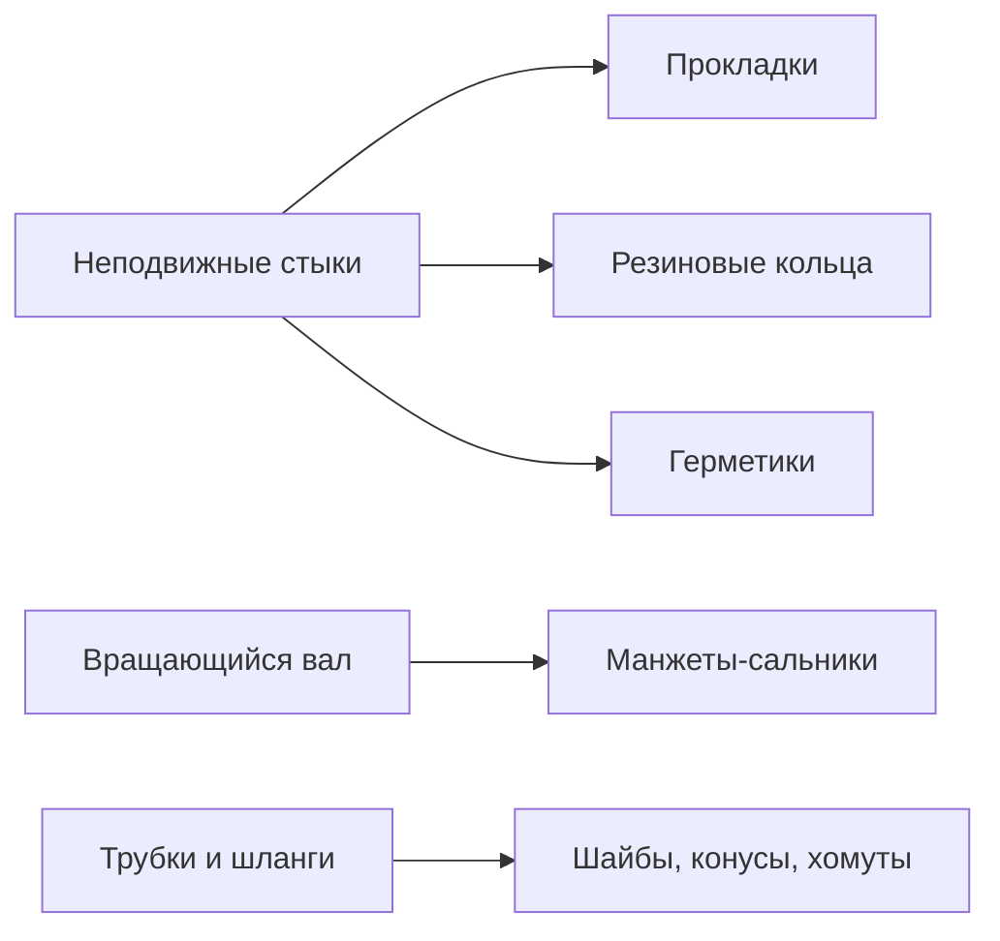

# День 10. Уплотнения: прокладки, кольца, манжеты, герметики

> [!abstract] Зачем это вам
> Внутри дизеля одновременно текут масло, охлаждающая жидкость, топливо, воздух и горячие газы, и почти все под давлением. Каждое место, где две детали соединяются, нужно **загерметизировать**. Течь — самый частый дефект, который находят на испытательном стенде, и в большинстве случаев её причина в сборке: старая прокладка, перекрученное кольцо, перевёрнутая манжета, лишний герметик.

## 🗺 Карта урока

## 🧩 Главное за 1 минуту
- Уплотнения бывают **неподвижные** (между двумя деталями: прокладки, кольца, герметик) и **подвижные** (на вращающемся валу: манжеты).
- **Прокладки, кольца, манжеты и медные шайбы ставят новыми.** Старые уже смяты и второй раз не держат.
- **Поверхности чистые**: старую прокладку и герметик снимают без царапин.
- **Резиновое кольцо**: не перекрутить, не порезать о резьбу, смазать тем, что указано в ТК.
- **Манжета**: рабочая кромка с пружиной смотрит **к маслу**; запрессовывать оправкой, ровно.
- **Герметик** только там и только такой, как в ТК, **тонким валиком**. Излишки попадут внутрь мотора.
- Трубка высокого давления уплотняется **конусом** (металл к металлу), без шайб и герметика.

---

## 🔍 1. Как работает уплотнение

Даже очень ровные на вид поверхности под микроскопом состоят из бугорков и впадин (вспомните шероховатость, урок 4). Через эти микрощели под давлением проходит жидкость. Уплотнение — это **мягкий материал между деталями**, который при сжатии заполняет все неровности.

![[прокладки_и_кольца.svg]]

Отсюда три главных правила любой герметизации:
1. **Поверхности чистые и целые.** Царапина поперёк уплотнения — готовый канал для течи.
2. **Уплотнение новое и правильное** (номер, материал, размер из ТК).
3. **Сжатие правильное**: момент и порядок затяжки по ТК (урок 7). Недотянули: течёт. Перетянули: прокладку выдавило или порвало.

---

## 🔍 2. Прокладки

| Тип | Где в дизеле | На что обратить внимание |
|---|---|---|
| **Металлическая многослойная** | Головка блока, выпускной коллектор | Метка «ВЕРХ/TOP», совпадение всех отверстий, ставят **сухой** |
| **Паронит, картон** | Крышки, фланцы, корпуса насосов, термостат | Не мять и не складывать; ставят сухой, если ТК не требует иного |
| **Резиновая** (в т. ч. формованная) | Клапанные крышки, поддон | Сидит в канавке, не выпала при установке крышки |
| **Медная или алюминиевая шайба** | Форсунки, пробки, поворотные штуцеры | **Всегда новая**: она уже смята в прошлый раз |

**Как ставить прокладку:**
1. Снять старую прокладку и остатки герметика **пластиковым скребком** или средством из ТК. Отвёрткой и наждаком нельзя: останутся царапины.
2. Обезжирить поверхности, если требует ТК.
3. Проверить, что **все отверстия прокладки совпали** с отверстиями деталей: масляный канал, закрытый прокладкой, оставит узел без масла.
4. Поставить деталь **на штифты или по направляющим**, не сдвигая прокладку.
5. Затянуть крепёж **по схеме и моменту** из ТК.

> [!warning] Прокладка из «того, что было»
> Вырезать прокладку самому, поставить две вместо одной, добавить герметик «для надёжности» — всё это нельзя, если так не написано в ТК. Толщина прокладки влияет на зазоры (например, в шестернях или насосах).

---

## 🔍 3. Резиновые кольца (кольца круглого сечения)

Кольцо лежит в **канавке** одной детали и сжимается второй деталью. Так уплотняют гильзы (урок 9), фильтры, трубки, датчики, крышки насосов.

**Правила:**
- Размер и **материал** кольца только из ТК. Кольца из разной резины выглядят одинаково, но одни держат горячее масло, а другие в нём разбухают.
- Перед установкой **смазать** тем, что указано: моторным маслом, силиконовой смазкой, специальной пастой. Без смазки кольцо может перекрутиться или порваться.
- **Не перекручивать.** Скрученное кольцо (видно по спиральной линии на поверхности) течёт.
- **Не тащить через резьбу и острые кромки**: надевают через защитную гильзу или обматывают резьбу лентой.
- **Не растягивать** сильнее необходимого: растянутое кольцо становится тоньше.
- При сборке следить, чтобы кольцо **не выдавилось из канавки** и не попало в стык (его срежет).

---

## 🔍 4. Манжеты (сальники)

Там, где **вал выходит из корпуса и вращается** (носок и хвостовик коленвала, валы насосов), ставят **манжету**. Её резиновая кромка с пружиной обнимает вал и не выпускает масло.

![[манжета_сальник.svg]]

**Как ставить:**
1. Проверить **номер** манжеты и её **направление**: рабочая кромка и пружина смотрят **внутрь, к маслу**. Часто на манжете есть стрелка направления вращения: она должна совпасть с вращением вала.
2. Гнездо в корпусе чистое, без забоин; вал гладкий, без задиров.
3. Запрессовать **оправкой**, которая давит по **наружному краю** манжеты по всему кругу, **ровно, без перекоса**, до упора или до размера по ТК.
4. Кромку **смазать** (чем, указано в ТК), надевать на вал **через защитную гильзу**, если на валу есть шпоночный паз, шлицы или резьба.
5. Не трогать кромку пальцами и инструментом: маленький надрыв = течь.

> [!tip] Почему перекос так опасен
> Если манжета стоит хотя бы чуть-чуть косо, кромка прижимается к валу неравномерно: с одной стороны слишком сильно (греется и изнашивается), с другой не касается (течёт).

---

## 🔍 5. Герметики

**Герметик** — паста, которая после сборки затвердевает (или остаётся эластичной) и уплотняет стык. Бывают **анаэробные** (твердеют без воздуха, в узком зазоре между металлом), **силиконовые** и другие.

![[герметик_штуцеры_патрубки.svg]]

**Правила:**
- Наносят **только там, где указано в ТК**, и **только указанной марки**.
- Поверхности **чистые, сухие, обезжиренные**.
- Валик **тонкий и сплошной**, внутри от отверстий болтов и вокруг них (как на схеме). Разрыв валика = течь.
- Собрать и затянуть **до того, как герметик начнёт схватываться** (время указано на упаковке или в ТК).
- **Излишки внутри двигателя недопустимы**: кусочки отрываются, забивают сетку маслоприёмника и масляные каналы.

> [!warning] Не путать с фиксатором резьбы
> Фиксатор резьбы (урок 6) тоже анаэробный, но наносится **в резьбу**, чтобы болт не откручивался. Герметик для фланцев и фиксатор для резьбы не взаимозаменяемы.

---

## 🔍 6. Штуцеры, трубки, патрубки

| Соединение | Чем уплотняется | Главное |
|---|---|---|
| **Поворотный штуцер** (кольцевой наконечник с полым болтом) | Две медные или алюминиевые шайбы | Обе шайбы новые, по одной с каждой стороны наконечника |
| **Трубка высокого давления** (топливо) | Конус трубки прижат к седлу, металл к металлу | Без шайб и герметика, момент по ТК, трубку не гнуть |
| **Штуцер с резиновым кольцом** | Кольцо в канавке | Кольцо новое, смазано, не перекручено |
| **Резиновый патрубок** (вода, воздух) | Хомут | Патрубок надет до упора, хомут за буртиком, момент хомута по ТК |
| **Резьбовая пробка** | Медная/алюминиевая шайба или кольцо | Шайба новая, момент по ТК (перетяг рвёт резьбу) |

---

## 🔍 7. Как проверяют герметичность

- **Опрессовка**: в систему подают воздух или жидкость под давлением и смотрят, держится ли давление и нет ли течи (часто с мыльным раствором для воздуха).
- **Осмотр** после холодной обкатки и на стенде (урок 14): сухие ли стыки, нет ли капель, «потения».
- Найденную течь **не исправляют подтяжкой «на глаз»**: сообщают мастеру, разбирают и ищут причину.

---

## 🛠 На рабочем месте
- Уплотнения выдают **комплектом на узел** и хранят в упаковке: на свету и в тепле резина стареет и трескается.
- Для манжет есть **набор оправок и защитных гильз**: спросите, где они.
- У каждого герметика есть **срок годности** и время до схватывания: смотрите упаковку.
- Срезанный кусок прокладки, кольца или валик герметика, упавший **внутрь** узла, нужно найти и достать.

## ⚠ Типичные ошибки новичка
> [!warning] Чего избегать
> 1. **Поставить старую** прокладку, кольцо или медную шайбу.
> 2. **Счищать прокладку отвёрткой** и поцарапать плоскость.
> 3. **Перекрутить или порезать** резиновое кольцо.
> 4. **Перевернуть манжету** или запрессовать её с перекосом.
> 5. **Намазать герметика «побольше»** или туда, где его нет в ТК.
> 6. **Поставить герметик на прокладку** без указания.
> 7. **Положить шайбу** под конус трубки высокого давления.
> 8. **Перетянуть** пробку или хомут.
> 9. **Не проверить**, что отверстия прокладки совпали с каналами.

## 🔀 У вашего завода может быть иначе
Формованные резиновые прокладки многоразового типа (только если это прямо разрешено), прокладки с нанесённым на заводе герметиком, манжеты из фторопласта (ставят сухими и строго своим инструментом), автоматическое нанесение герметика роботом.

## 📷 Фото-задание
Сфотографируйте: **прокладку головки** (найдите метку «ВЕРХ»), **манжету коленвала** (найдите пружину и стрелку вращения), **набор резиновых колец**, **поворотный штуцер с шайбами**, **тюбик герметика** с маркой.

## ✅ Самопроверка
> [!question]- 1. Почему прокладку нельзя ставить второй раз?
> - [ ] Можно ставить, если не порвана
> - [x] Она уже смята под неровности и не заполнит их снова: потечёт
> - [ ] Она поменяет цвет
> - [ ] Она станет толще
>
> Она уже смята под неровности деталей и при повторной затяжке не заполнит их: потечёт.

> [!question]- 2. Чем снимать старую прокладку?
> - [x] Пластиковым скребком или средством из ТК
> - [ ] Отвёрткой
> - [ ] Наждачной бумагой
> - [ ] Болгаркой с лепестковым кругом
>
> Пластиковым скребком или средством из ТК, без царапин. Не отвёрткой и не наждаком.

> [!question]- 3. Как понять, что резиновое кольцо перекручено?
> - [ ] Оно стало темнее
> - [ ] Оно мягкое на ощупь
> - [ ] Это никак не проверить
> - [x] На нём видна спиральная линия, лежит в канавке неровно
>
> На нём видна спиральная линия, оно лежит в канавке неровно.

> [!question]- 4. Куда должна смотреть рабочая кромка манжеты?
> - [ ] Наружу, к пыли
> - [ ] Неважно, манжета симметричная
> - [x] Внутрь, к маслу (пружиной к маслу)
> - [ ] Вверх
>
> Внутрь, к маслу (пружиной к маслу).

> [!question]- 5. Как надеть манжету на вал со шпоночным пазом?
> - [ ] Растянуть пальцами и быстро надеть
> - [x] Через защитную гильзу, со смазанной кромкой
> - [ ] Насухо, с поворотом
> - [ ] Подрезать кромку, чтобы легче шла
>
> Через защитную гильзу, со смазанной кромкой.

> [!question]- 6. Почему опасно много герметика?
> - [x] Излишки выдавливаются внутрь и забивают маслоприёмник и каналы
> - [ ] Это просто дорого
> - [ ] Деталь потом трудно снять
> - [ ] Не опасно: чем больше, тем надёжнее
>
> Излишки выдавливаются внутрь, отрываются и забивают сетку маслоприёмника и каналы.

> [!question]- 7. Чем уплотняется трубка высокого давления?
> - [ ] Медной шайбой
> - [ ] Герметиком на резьбу
> - [ ] Резиновым кольцом
> - [x] Конусом трубки по седлу, металл к металлу, без шайб и герметика
>
> Конусом трубки по седлу, металл к металлу, без шайб и герметика.

> [!question]- 8. Сколько шайб у поворотного штуцера и какие?
> - [ ] Одна, под головку болта
> - [ ] Две старые, если не повреждены
> - [x] Две новые, по одной с каждой стороны наконечника
> - [ ] Ни одной, ставят на герметик
>
> Две, по одной с каждой стороны наконечника, обе новые.

## ❓ 3 вопроса наставнику
1. Какие герметики мы применяем, на каких узлах и сколько времени до схватывания?
2. Какой смазкой смазывать резиновые кольца гильз и фильтров?
3. Где оправки и защитные гильзы для манжет коленвала?

## 📚 Термины
[[Глоссарий/Манжета]] · [[Глоссарий/Резиновое кольцо]] · [[Глоссарий/Герметик]] · [[Глоссарий/Опрессовка]] · [[Глоссарий/Прокладка головки]] · [[Глоссарий/Фиксатор резьбы]] · [[Глоссарий/Шероховатость]]

## ➡ Дальше
Дополнительный урок: [[11_Единицы_измерения]]. Потом неделя 2: [[01_Обзор_и_принцип_работы]]
