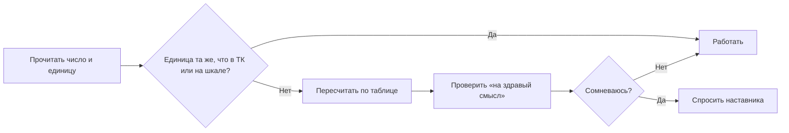

# День 1. Единицы измерения: мм, микроны, Н·м, МПа, бары и всё остальное

> [!abstract] Зачем это вам
> В ТК, на шкалах приборов и в разговоре в цеху постоянно звучат числа с единицами: «зазор пять соток», «момент сто двадцать ньютон-метров», «давление масла четыре бара». Перепутать единицу — значит ошибиться в 10, 100 или 1000 раз. Этот урок можно прочитать **первым**, до урока 4: он объясняет все единицы, которые встречаются в курсе.

## 🗺 Карта урока

## 🧩 Главное за 1 минуту
- **1 мм = 1000 мкм.** «Сотка» = 0,01 мм, «десятка» = 0,1 мм, «микрон» = 0,001 мм.
- **Маленькая «м» = милли** (тысячная), **большая «М» = мега** (миллион). Не путать.
- **Килограмм — масса, ньютон — сила.** Груз 1 кг давит с силой ≈ 10 Н.
- **Момент затяжки — в Н·м.** Старое: 1 кгс·м ≈ 9,81 Н·м.
- **Давление: 1 МПа = 10 бар.** 1 бар ≈ 1 кгс/см² ≈ 1 атмосфера.
- **Доворот на 90° = четверть оборота.** Цикл двигателя = 720° = 2 оборота вала.
- Число без единицы ничего не значит: **всегда смотрите, в чём оно записано**.

---

## 🔍 1. Приставки и длина

![[длина_и_приставки.svg]]

**Как это звучит в цеху:**

| Говорят | Записывают | Что значит |
|---|---|---|
| «Пять соток» | 0,05 мм | Пять сотых миллиметра |
| «Две десятки» | 0,2 мм | Две десятых миллиметра |
| «Десять микрон» | 10 мкм = 0,01 мм | Одна сотка |
| «Полтора миллиметра» | 1,5 мм | |
| «Дюйм» | 1" = 25,4 мм | Встречается в импортных инструментах и резьбах |

> [!tip] Как не потеряться в нулях
> Считайте **знаки после запятой** в миллиметрах:
> - один знак (0,**1**) — десятые, «десятки»;
> - два знака (0,0**5**) — сотые, «сотки»;
> - три знака (0,00**5**) — тысячные, микроны.

---

## 🔍 2. Масса, сила, момент, давление

![[сила_момент_давление.svg]]

### Масса и сила
**Килограмм (кг)** — это масса, «сколько вещества». **Ньютон (Н)** — это сила, «как сильно давят или тянут». Груз массой 1 кг тянет вниз с силой примерно **9,81 Н** (для прикидки в уме **10 Н**). В старых документах сила указана в **кгс** (килограмм-сила): **1 кгс ≈ 9,81 Н**.

Крупные силы пишут в **кН** (килоньютонах): 1 кН = 1000 Н ≈ 100 кгс. Например, «пресс 50 кН» давит примерно как груз в 5 тонн.

### Момент
**Момент** = сила × плечо (подробно в уроке 7). Основная единица **Н·м** (ньютон-метр). Иногда пишут «Нм», это то же самое.

| Если в документе | Перевести в Н·м | Пример |
|---|---|---|
| кгс·м | × 9,81 | 12 кгс·м ≈ 118 Н·м |
| lbf·ft (фунт-фут) | × 1,356 | 100 lbf·ft ≈ 136 Н·м |
| Н·см | ÷ 100 | 500 Н·см = 5 Н·м |

### Давление
**Давление** = сила, делённая на площадь. Единиц много, и все встречаются в цеху:

| Единица | Сколько в 1 МПа | Где встретите |
|---|---|---|
| **МПа** (мегапаскаль) | 1 | Документация, ТК |
| **кПа** (килопаскаль) | 1000 | Датчики, давление наддува |
| **бар** | 10 | Манометры, разговор в цеху |
| **кгс/см²** («атмосфера») | ≈ 10,2 | Старые манометры и документы |
| **psi** | ≈ 145 | Импортные приборы |

Главная связка, которую стоит выучить: **1 МПа = 10 бар; 1 бар ≈ 1 кгс/см² ≈ 1 атм**.

> [!warning] Манометр показывает «лишнее» давление
> Обычный манометр показывает, насколько давление **выше атмосферного**. Поэтому на неработающем двигателе он стоит на нуле, хотя воздух вокруг давит примерно на 1 бар. В документах это называют **избыточным** давлением.

---

## 🔍 3. Углы, температура, объём, мощность

![[углы_температура_объём.svg]]

| Величина | Единица | Что важно |
|---|---|---|
| **Угол** | градус (°) | 360° = 1 оборот; 90° = ¼ оборота. Углы поворота коленвала (ВМТ, фазы, опережение впрыска) считают в градусах |
| **Обороты** | об/мин | Скорость вращения вала |
| **Температура** | °C | Детали меряют при температуре цеха (~20 °C); нагретая деталь больше |
| **Объём** | л, мл, см³ | 1 л = 1000 мл = 1000 см³. Заправка маслом и жидкостью: строго объём из ТК |
| **Мощность** | кВт, л.с. | 1 л.с. ≈ 0,74 кВт; 1 кВт ≈ 1,36 л.с. |
| **Масса** | кг, т | 1 т = 1000 кг. Масса двигателя V12: тонны |
| **Шероховатость** | мкм | Ra 0,8 = средняя высота неровностей 0,8 мкм (урок 4) |

---

## 🔍 4. Как пересчитывать без ошибок

**Проверка «на здравый смысл»** — главный приём. Пересчитали и прикиньте, похоже ли на правду:
- зазор клапана **0,3 мм** похож на правду, а **3 мм** — нет (клапан болтался бы);
- момент болта М10 **несколько десятков Н·м** похож на правду, а **500 Н·м** — нет (болт оторвётся);
- давление масла **3–6 бар** похоже, а **40 бар** — нет.

> [!danger] Не пересчитывайте «в уме на ходу»
> Если в ТК момент в одних единицах, а ключ размечен в других, пересчитайте **на бумаге** и **дайте проверить** наставнику или мастеру. Ошибка в 9,81 раза (кгс·м вместо Н·м) — классическая причина сорванных или недотянутых болтов.

---

## 🛠 На рабочем месте
- Посмотрите, **в каких единицах размечены** ваши динамометрические ключи и манометры. Бывают ключи с двумя шкалами (Н·м и lbf·ft) и манометры с двумя шкалами (МПа и бар, бар и psi).
- В ТК единица обычно стоит рядом с числом или в заголовке столбца таблицы. Не нашли: спросите.
- Записывая замер в карту, **пишите единицу**, если её нет в бланке.

## ⚠ Типичные ошибки новичка
> [!warning] Чего избегать
> 1. **Перепутать 0,05 и 0,5 мм** (ошибка в 10 раз).
> 2. **Перепутать кгс·м и Н·м** (ошибка почти в 10 раз).
> 3. **Перепутать бар и МПа** (ошибка в 10 раз).
> 4. **Перепутать мм и мкм** (ошибка в 1000 раз).
> 5. **Читать не ту шкалу** на приборе с двумя шкалами.
> 6. **Записать число без единицы.**
> 7. **Пересчитать и не проверить на здравый смысл.**

## 🔀 У вашего завода может быть иначе
Старая документация в кгс, кгс·м и кгс/см², импортная в дюймах, psi и lbf·ft. Электронные приборы, которые переключают единицы кнопкой (проверяйте, что стоит на экране).

## 📷 Фото-задание
Сфотографируйте **шкалу динамометрического ключа**, **манометр** на стенде или участке и **строку ТК** с моментом или давлением. Подпишите, в каких они единицах.

## ✅ Самопроверка
> [!question]- 1. Сколько миллиметров в 5 сотках? А в 25 микронах?
> - [ ] 0,5 мм и 0,25 мм
> - [x] 0,05 мм и 0,025 мм
> - [ ] 0,005 мм и 0,0025 мм
> - [ ] 0,05 мм и 0,25 мм
>
> 5 соток = 0,05 мм. 25 мкм = 0,025 мм.

> [!question]- 2. Что больше: 0,08 мм или 0,1 мм?
> - [x] 0,1 мм
> - [ ] 0,08 мм
> - [ ] Они равны
> - [ ] Без единиц сравнить нельзя
>
> 0,1 мм (это 10 соток, а 0,08 мм — 8 соток).

> [!question]- 3. В старой ТК момент 8 кгс·м. Сколько это в Н·м?
> - [ ] ≈8 Н·м
> - [ ] ≈800 Н·м
> - [ ] ≈0,8 Н·м
> - [x] ≈78 Н·м
>
> 8 × 9,81 ≈ 78 Н·м.

> [!question]- 4. Манометр показывает 0,45 МПа. Сколько это в барах?
> - [ ] 45 бар
> - [ ] 0,45 бар
> - [x] 4,5 бар
> - [ ] 450 бар
>
> 4,5 бар.

> [!question]- 5. Чем отличаются мПа и МПа?
> - [ ] Одно и то же, просто разный регистр
> - [x] мПа — миллипаскаль, МПа — мегапаскаль: разница в миллиард раз
> - [ ] Разница в тысячу раз
> - [ ] мПа больше МПа
>
> мПа — миллипаскаль (тысячная паскаля), МПа — мегапаскаль (миллион паскалей). Разница в миллиард раз.

> [!question]- 6. На сколько оборотов повернуть болт при «довороте на 180°»?
> - [x] На пол-оборота
> - [ ] На четверть оборота
> - [ ] На полный оборот
> - [ ] На два оборота
>
> На пол-оборота.

> [!question]- 7. Давление масла записали как «40 бар». Что делать?
> - [ ] Записать как есть
> - [ ] Это нормальное давление масла в дизеле
> - [ ] Срочно стравить давление
> - [x] Проверить на здравый смысл: слишком много, перепроверить и спросить
>
> Проверить на здравый смысл: для масла в двигателе это слишком много (обычно единицы бар). Вероятно, ошибка в единицах или в записи: перепроверить и спросить.

> [!question]- 8. Пресс развивает 20 кН. Это примерно сколько тонн «веса»?
> - [ ] ≈20 т
> - [ ] ≈200 кг
> - [x] ≈2 т
> - [ ] ≈20 кг
>
> 20 кН ≈ 2000 кгс ≈ 2 т.

## ❓ 3 вопроса наставнику
1. В каких единицах у нас записаны моменты и давления в ТК?
2. Есть ли у нас ключи или манометры с двумя шкалами, и какую читать?
3. Какие цеховые словечки для единиц у нас в ходу («сотка», «атмосфера», «кило»)?

## 📚 Термины
[[Глоссарий/Момент затяжки]] · [[Глоссарий/Допуск]] · [[Глоссарий/Шероховатость]] · [[Глоссарий/Доворот на угол]] · [[Глоссарий/Микрометр]]

## ➡ Дальше
Неделя 2: [[01_Обзор_и_принцип_работы]] · план курса: [[00_План_курса]]
