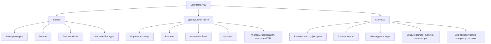

# День 8. Что такое 12-цилиндровый дизель и как он работает

> [!abstract] Зачем это слесарю-сборщику
> Вы будете собирать узлы, которые связаны друг с другом. Если понимаете, **зачем** деталь стоит именно так (а не просто «так сказали»), вы реже ошибаетесь, быстрее запоминаете и лучше понимаете мастера. Сегодня задача одна: получить общую картину. Детали пойдут в следующих уроках.

## 🗺 Карта урока


## 🧩 Главное за 1 минуту
- Двигатель превращает **тепло от сгорания топлива** в **вращение вала**.
- В дизеле топливо **не поджигается свечой**. Воздух сильно сжимают, он раскаляется, и впрыснутое топливо вспыхивает само.
- Один цилиндр работает по циклу из **4 тактов**: впуск, сжатие, рабочий ход, выпуск.
- «**V12**» значит: 12 цилиндров, два ряда по 6, расположены буквой **V**.
- Цилиндры работают **по очереди**, в строго заданном порядке, чтобы вращение было ровным.
- Двигатель делится на **«каркас»** (блок, головки), **«движущиеся части»** (поршни, шатуны, коленвал) и **системы** (топливо, масло, вода, воздух).

---

## 🔍 1. Что делает двигатель: простая картинка

Представьте велосипед. Нога давит на педаль вниз, и цепь вращает колесо. Двигатель делает то же самое:

| Велосипед | Двигатель |
|---|---|
| Нога давит вниз | Газы от сгорания давят на **поршень** |
| Шатун-«голень» | **Шатун** передаёт усилие |
| Педали и кривошип | **Коленчатый вал** превращает движение вверх-вниз во вращение |
| Колесо | **Маховик** (на выходе вал вращает коробку передач/генератор/насос) |

В двигателе «ног» не одна, а **двенадцать**, и они работают по очереди. Поэтому вращение получается ровным и мощным.

---

## 🔍 2. Как работает дизель: 4 такта

![[4_такта_дизеля.svg]]

> [!example] Запомните по-простому
> **Впустил → сжал → взорвал → выбросил.**
> Всё это происходит в одном цилиндре за **два оборота** коленвала.

Пошагово:

1. **Впуск.** Поршень идёт вниз, открывается впускной клапан, в цилиндр входит **чистый воздух** (без топлива!).
2. **Сжатие.** Клапаны закрыты, поршень идёт вверх и сильно сжимает воздух. От сжатия воздух раскаляется, как насос, который греется при накачке шины.
3. **Рабочий ход.** В конце сжатия **форсунка** впрыскивает топливо мелкими брызгами. Оно вспыхивает само, газы давят на поршень, и поршень идёт вниз. **Это единственный такт, который даёт работу.**
4. **Выпуск.** Поршень идёт вверх, открывается выпускной клапан, отработавшие газы уходят.

> [!tip] Чем дизель отличается от бензинового
> | | Бензиновый | Дизель |
> |---|---|---|
> | Что засасывает | Смесь воздуха и топлива | Только воздух |
> | Чем поджигается | Свечой | Сжатием (само) |
> | Сжатие | слабое (степень сжатия ~10) | сильное (~15–18, `~пример`) |
> | Нагрузки на детали | меньше | **выше**, детали массивнее, посадки жёстче |

**Что это значит для сборщика:** в дизеле большие давления, поэтому важны **точные моменты затяжки** (головки, шатуны), **чистота** и **правильные зазоры**.

---

## 🔍 3. Почему 12 цилиндров и почему «V»

**Зачем много цилиндров?** Один цилиндр даёт силу только раз в 2 оборота (в такте №3). Между толчками вал вращается по инерции, поэтому одноцилиндровый мотор «дёргается». Чем больше цилиндров, тем чаще толчки и тем ровнее ход. Плюс общая мощность складывается.

**Зачем буква V?** 12 цилиндров в одну линию получились бы очень длинными (как вагон). Если поставить два ряда по 6 под углом, двигатель станет в два раза короче и компактнее.

![[v12_вид_спереди.svg]]

- **Развал** (угол между рядами) у разных моторов разный. Часто встречаются **60°, 75°, 90°**.
- Между рядами остаётся «долина» (в ней обычно стоят впускной коллектор, иногда турбина, трубки).
- У каждого ряда своя **головка блока** (или несколько головок на ряд).

> [!question]- Как запомнить?
> Откройте ладони вверх и поставьте их под углом буквой V, как будто держите арбуз. **Ладони это два ряда цилиндров, а запястья сходятся внизу в точке, где находится коленвал.**

---

## 🔍 4. Нумерация цилиндров и порядок работы

![[v12_вид_сверху_нумерация.svg]]

**Нумерация.** Цилиндры считаются от «передней» стороны (где вентилятор), у каждого ряда свой счёт. Бывает по-разному: 1–6 и 7–12, или 1Л–6Л и 1П–6П. **Не гадайте, смотрите табличку/чертёж/ТК.**

**Порядок работы.** Цилиндры «стреляют» не по очереди 1-2-3-4…, а **вперемешку**. Например, для ЯМЗ-240 в справочниках приводят `1-12-5-8-3-10-6-7-2-11-4-9` `#проверить` (при нумерации 1–6 левый ряд, 7–12 правый).

> [!example] Посмотрите на этот порядок внимательно
> 1 (левый) → 12 (правый) → 5 (левый) → 8 (правый) → 3 (левый) → 10 (правый)…
> Цилиндры **левого и правого рядов чередуются**: левый, правый, левый, правый. Так нагрузка «качается» с ряда на ряд и не собирается на одной стороне.

**Зачем?**
- Толчки равномерно распределены по длине вала. Один участок не перегружается.
- Левый и правый ряды (их ещё называют ряд «А» и ряд «Б») работают поочерёдно, нагрузки уравновешиваются.
- Соседние цилиндры не стреляют подряд, поэтому лучше наполняются воздухом и не мешают друг другу.

Всего 12 толчков за 2 оборота вала (720°), то есть примерно один толчок каждые **60° поворота**, если развал и схема шатунов выбраны «ровно». У некоторых V12 интервалы бывают чередующимися (например, 45°/75°) `#проверить`.

> [!warning] Где вам это пригодится
> Порядок работы нужен при **регулировке клапанов** и **установке топливных трубок/форсунок**: если перепутать цилиндры, двигатель не заведётся или будет работать с перебоями. Всегда сверяйтесь с ТК.

---

## 🔍 5. Из чего состоит двигатель: карта частей

Так двигатель выглядит снаружи. Найдите каждую цифру на картинке и прочитайте, что это. Потом закройте список и попробуйте назвать детали по памяти.

![[v12_общий_вид_сбоку.svg]]

А так эти части делятся по смыслу:



Таблица «что за что отвечает»:

| Часть | Что делает | Образное сравнение |
|---|---|---|
| [[Глоссарий/Блок цилиндров\|Блок цилиндров]] | Основа, «скелет», держит всё остальное | Корпус дома |
| [[Глоссарий/Гильза\|Гильза]] | «Труба», по которой ходит поршень | Ствол шприца |
| [[Глоссарий/Поршень\|Поршень]] | Принимает давление газов | Поршень шприца |
| [[Глоссарий/Шатун\|Шатун]] | Соединяет поршень с валом | Рука/нога |
| [[Глоссарий/Коленчатый вал\|Коленвал]] | Превращает возвратное движение во вращение | Педали и кривошип |
| [[Глоссарий/Головка блока\|Головка блока]] | Крышка цилиндров, в ней клапаны и форсунки | Крышка кастрюли с «дверцами» |
| [[Глоссарий/Клапан\|Клапаны]] | Впускают воздух и выпускают газы | Двери «вход/выход» |
| [[Глоссарий/Распредвал\|Распредвал + ГРМ]] | Открывает и закрывает клапаны вовремя | Дирижёр |
| [[Глоссарий/Форсунка\|Форсунка]] и [[Глоссарий/ТНВД\|ТНВД]] | Подают топливо под давлением | Распылитель и насос |
| [[Глоссарий/Турбокомпрессор\|Турбокомпрессор]] | Нагнетает больше воздуха, больше мощности | Вентилятор на выхлопных газах |
| Масляная система | Смазка и охлаждение трущихся деталей | Кровь |
| Система охлаждения | Отводит лишнее тепло | Радиатор отопления наоборот |

> [!info] Не пугайтесь количества
> Всё это вы узнаете по частям: дни 9–13 разберут каждый узел. Сегодня достаточно понимать, **где что стоит и зачем**.

---

## 🛠 На рабочем месте: что вижу, что делаю руками

- Двигатель большой и тяжёлый: собранный V12 весит **около 1,5–4 тонн** `~пример`. Его перемещают краном или на специальной оснастке (стенд-«кантователь», поворотный стенд).
- Вы увидите **ряды одинаковых узлов**: шесть головок/крышек в каждом ряду, шесть форсунок в ряду и т. д. Одинаковость подсказывает: **шесть раз одно и то же, нужно не ошибиться**.
- Многие узлы маркированы (цифры/метки) по цилиндрам: **не путайте местами**.
- Всё, что идёт внутрь двигателя (поршни, вкладыши, клапаны), **не должно быть загрязнено**. Одна стружка может убить подшипник.

## ⚠ Типичные ошибки новичка

> [!warning] Чего избегать
> 1. **Путать цилиндры/ряды** (левый/правый, 1–6 / 7–12). Всегда сверяйтесь с картой.
> 2. **Считать, что «нет разницы»** между одинаковыми на вид деталями (поршни, вкладыши, клапаны бывают по группам/размерам, впускные и выпускные отличаются).
> 3. **Затягивать «на глаз»**, а не по моменту.
> 4. **Запоминать цифры наизусть** вместо того, чтобы открыть ТК.
> 5. **Стесняться спросить.** На заводе это нормально, а ошибка из-за нежелания спросить стоит дороже.

## 🔀 У вашего мотора может быть иначе

| Что | Варианты |
|---|---|
| Развал рядов | 60°, 75°, 90° |
| Гильзы | мокрые (омываются водой) или сухие / блок цельный |
| Головки | одна на ряд или отдельные на каждый цилиндр |
| Шатуны | два шатуна рядом на одной шейке или «главный + прицепной» |
| Подача топлива | секционный ТНВД (по секции на цилиндр) или Common Rail (общая «рампа») |
| Наддув | без наддува, с одним, с двумя турбокомпрессорами, с охладителем воздуха |
| Нумерация | 1–12 или 1Л–6Л/1П–6П |

> [!tip] Как определить у себя
> Спросите наставника: «**Какая у нас схема: сколько рядов, какой угол, какое топливное оборудование?**» Ответ добавьте в заметку «Мой двигатель» (шаблон ниже).

```markdown
# Мой двигатель
- Модель: 
- Развал: 
- Гильзы: мокрые / сухие
- Топливо: секционный ТНВД / Common Rail
- Наддув: нет / 1 турбина / 2 турбины
- Нумерация цилиндров: 
- Порядок работы: 
```

## 📷 Фото-задание

Положите в `Вложения/фото/` и вставьте сюда (`![[имя.jpg]]`):
1. Общий вид двигателя сбоку и спереди (если можно снимать).
2. Табличка/шильдик с моделью двигателя.
3. Любые метки/номера цилиндров на блоке или головках.

*(Если снимать нельзя, достаточно найти фото в интернете и положить в папку для себя.)*

## ✅ Самопроверка

> [!question]- 1. Назовите 4 такта по порядку
> Впуск → сжатие → рабочий ход → выпуск.

> [!question]- 2. Какой из тактов даёт работу?
> Рабочий ход (3-й). Остальные три только подготавливают или завершают.

> [!question]- 3. Чем дизель отличается от бензинового по поджигу?
> В дизеле топливо воспламеняется само от сильного сжатия и нагрева воздуха, без свечи.

> [!question]- 4. Что значит «V12»?
> 12 цилиндров, два ряда по 6, расположены под углом (буквой V).

> [!question]- 5. Зачем нужен порядок работы цилиндров?
> Чтобы толчки были равномерными, нагрузка на вал распределялась ровно, а ряды работали поочерёдно.

> [!question]- 6. Сколько оборотов делает вал за полный цикл одного цилиндра?
> Два оборота (720°).

> [!question]- 7. Что превращает движение поршня вверх-вниз во вращение?
> Шатун вместе с коленчатым валом.

> [!question]- 8. Почему нельзя считать нумерацию цилиндров «одинаковой у всех моторов»?
> Потому что у разных моделей бывает разная нумерация и порядок работы. Смотрите документацию на свой двигатель.

## ❓ 3 вопроса наставнику
1. Какая у нас модель двигателя, какой развал и какие особенности (топливо, наддув, гильзы)?
2. Как у нас нумеруются цилиндры и где это можно увидеть на детали/чертеже?
3. На каком этапе сборки чаще всего допускают ошибки новички?

## 📚 Термины
[[Глоссарий/Блок цилиндров]] · [[Глоссарий/Гильза]] · [[Глоссарий/Поршень]] · [[Глоссарий/Шатун]] · [[Глоссарий/Коленчатый вал]] · [[Глоссарий/Головка блока]] · [[Глоссарий/Клапан]] · [[Глоссарий/Распредвал]] · [[Глоссарий/Форсунка]] · [[Глоссарий/ТНВД]] · [[Глоссарий/Турбокомпрессор]] · [[Глоссарий/Степень сжатия]] · [[Глоссарий/Развал]]

## ➡ Дальше
[[02_Блок_цилиндров_и_гильзы]] (день 9)
