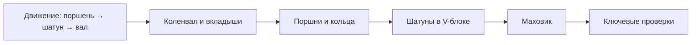

# День 11. Кривошипно-шатунный механизм: коленвал, шатуны, поршни

> [!abstract] Зачем это слесарю-сборщику
> Это **сердце двигателя**, то, что превращает взрыв в движение. Здесь самые точные зазоры и самые ответственные болты. Здесь же самые дорогие ошибки: одна перевёрнутая деталь или грязь на вкладыше означает поломку двигателя после запуска.

## 🗺 Карта урока

## 🧩 Главное за 1 минуту
- **КШМ** = коленвал + шатуны + поршни + маховик.
- **Вкладыши** — тонкие подшипники скольжения между валом и опорой. Между ними **масляная плёнка** (зазор!).
- **Поршневые кольца**: 2 компрессионных (держат газы) + 1 маслосъёмное. **Замки колец разводят.**
- **Шатунные болты** — самые ответственные: затягивают строго по ТК (часто момент + угол), чаще **одноразовые**.
- Перед каждой установкой вала/поршня — **чистота и смазка** (чистым маслом по ТК).
- После затяжки каждой крышки **проверяют, что вал проворачивается свободно**.

---

## 🔍 1. Как это работает

![[кшм_движение.svg]]

Газы толкают **поршень**, он давит на **шатун**, шатун поворачивает **коленвал** (как нога на педаль). Поршень ходит между **ВМТ** (верхняя мёртвая точка) и **НМТ** (нижняя). За один оборот вала поршень проходит вниз и вверх.

---

## 🔍 2. Коленчатый вал и вкладыши

**Коленчатый вал** — стальной вал с «коленями». У него:

![[коленвал_шейки.svg]]

| Элемент | Что это |
|---|---|
| **Коренные шейки** | Опорные «цилиндры», лежат в блоке |
| **Шатунные шейки** | Смещённые от оси, на них сидят шатуны |
| **Щёки и противовесы** | Уравновешивают вращающиеся массы |
| **Масляные каналы** | Сверлёные отверстия, подают масло к шатунным шейкам |
| **Носок / хвостовик** | Спереди носок (шкив, гаситель колебаний). Сзади хвостовик: у ЯМЗ-240 на нём шестерня распределения, а за ней фланец маховика |

> [!example] Аналогия
> Вал — как **ось велосипеда с педалями**. Педали — шатунные шейки. Опоры — коренные.

**Вкладыши** — тонкостенные «полукольца» (две половины) с антифрикционным слоем. Они стоят между валом и блоком (**коренные**) и между валом и шатуном (**шатунные**).

![[вкладыш_установка.svg]]

Главное про вкладыши:
- Бывают **верхние и нижние** (различаются: одна половина с **канавкой и отверстием** для масла, другая без, или обе с канавкой).
- У каждой половины есть **«усик»** (выступ), фиксирующий положение. Он входит в паз блока/крышки.
- Масляные **отверстия во вкладыше должны совпасть** с отверстиями в блоке.
- Их **не подгоняют** (не шлифуют, не подпиливают).
- Рабочую поверхность **не трогают пальцами** и ничем не царапают.
- **Смазывают** чистым маслом по ТК перед установкой вала.

**Установка вала (общий порядок, детали в ТК):**
1. Блок чистый, **вкладыши в постелях** (усики в пазах, отверстия совпадают).
2. **Смазать** вкладыши и шейки вала чистым маслом.
3. Аккуратно **уложить вал** в постели (краном/подъёмником, не касаясь шейками стенок).
4. Установить **упорные полукольца** (ограничивают продольный ход вала, ставят по ТК).
5. Установить **крышки** с вкладышами по меткам и номерам.
6. Затянуть болты крышек **по схеме и в несколько проходов**, после **каждой крышки** проверять, что вал вращается свободно (так сразу видно, какая крышка «зажала» вал). У ЯМЗ-240 на крышке **4 болта**: 2 вертикальных и 2 горизонтальных стяжных (через стенки картера в бока крышки). Обычно сначала тянут вертикальные, потом стяжные; точный порядок, моменты и углы — **по ТК**.
7. Проверить **осевой (продольный) люфт** вала индикатором.

> [!warning] Типичный брак
> **Вал вращается туго** после затяжки крышки означает остановиться: возможно, перепутаны вкладыши/крышки, попала грязь или усик не в пазу. **Не продолжайте.** Сообщите мастеру.

---

## 🔍 3. Поршень и кольца

![[поршень_и_кольца.svg]]

**Поршень** принимает давление газов. На нём:
- **канавки для колец** (обычно 3–4),
- **отверстие под палец** (бобышки),
- **камера сгорания** в днище (в дизелях часто есть выемка: она направляет воздух и топливо).

**Кольца:**

| Кольцо | Что делает | Особенность |
|---|---|---|
| **Компрессионное 1** (верхнее) | Удерживает газы | Самое нагруженное, часто специальное покрытие |
| **Компрессионное 2** | Дополнительно уплотняет, снимает масло | Часто имеет «скребок», ставят **правильной стороной** |
| **Маслосъёмное** | Снимает лишнее масло со стенки гильзы | Составное (расширитель + кольца) |

**Важные правила установки колец:**
1. **Метка «ВЕРХ/TOP»** (или буква/точка) смотрит **вверх**, к днищу поршня.
2. **Не растягивать лишний раз.** Надевать специальным съёмником/щипцами, не пальцами «на излом».
3. **Замки разводят** (например, под ~120° друг к другу, **не по оси пальца**). Смотрите ТК.
4. **Замковый зазор** (щель в замке) проверяют, вставив кольцо в гильзу, щупом.
5. Кольца **смазывают** чистым маслом перед установкой в гильзу.

**Установка поршня в гильзу:**
1. Смазать гильзу и поршень чистым маслом.
2. Сжать кольца **специальной оправкой** (обжимкой).
3. **Ориентация поршня:** метка (стрелка/надпись) смотрит в сторону, указанную в ТК (например, «к переду двигателя»).
4. Аккуратно **вдвинуть** поршень в гильзу, направляя шатун на шатунную шейку (чтобы не задеть шейку и не повредить вкладыш).

> [!warning] Не бейте по поршню
> Деревянная/пластиковая ручка молотка, **плавное нажатие**, без ударов. Если не идёт, значит кольцо где-то сжато неправильно. Остановитесь.

---

## 🔍 4. Шатун и «V-блок»

**Шатун** — стальной стержень с двумя «головками»:
- **верхняя** (малая) надевается на поршневой палец; в неё запрессована **втулка**;
- **нижняя** (большая) разъёмная: охватывает шатунную шейку через **вкладыши**; крышка крепится **шатунными болтами**.

**Особенность V-образного двигателя:** на **одной шатунной шейке** работают **два шатуна** (по одному от левого и правого рядов). Бывает две схемы:

| Схема | Как выглядит |
|---|---|
| **Рядом** | Два шатуна стоят рядом на одной шейке (чуть смещены цилиндры рядов) |
| **«Главный + прицепной»** | Один шатун главный, второй цепляется к нему пальцем |

**Что делает сборщик:**
1. Проверить **метки на шатуне и крышке** (номер цилиндра/пары), они **должны совпадать**.
2. Установить **вкладыши** (усики в пазах, отверстия совпадают, не трогать поверхность).
3. Смазать, надеть на шейку, установить **крышку по меткам**.
4. **Затянуть болты** строго по ТК: часто **момент + доворот на угол**, болты **одноразовые**.
5. Проверить **свободное вращение** и **боковой зазор** шатуна.

---

## 🔍 5. Маховик и торцевая сторона

**Маховик** — тяжёлый диск на конце вала. Выравнивает вращение между рабочими ходами и несёт венец для стартера.

- Крепится **болтами** (часто на фиксирующих штифтах, чтобы всегда становился в одно положение).
- **Затяжка** динамометрическим ключом по схеме.
- Проверяется **торцевое биение** индикатором.

---

## 🛠 На рабочем месте
- Эти узлы **собирают на стенде**, блок часто переворачивают.
- Детали подаются **с маркировкой и группами**. Не смешивать.
- Перед установкой вала или поршней обычно требуется **чистая зона** и **чистые перчатки/руки**.
- Все замеры (зазоры, люфт, биение) **записывают в карту**.

## ⚠ Типичные ошибки новичка
> [!warning] Чего избегать
> 1. **Поставить вкладыш «наоборот»** (отверстие не совпало).
> 2. **Забыть смазать** шейки и вкладыши.
> 3. **Перепутать крышки/шатуны** по номерам.
> 4. **Повернуть поршень не той стороной** (метка не туда).
> 5. **Установить кольца вверх ногами** или с совпавшими замками.
> 6. **Использовать повторно** шатунные болты, которые по ТК одноразовые.
> 7. **Не проверить свободное вращение** вала после затяжки.
> 8. **Ударить поршень молотком**, чтобы «проскочил».

## 🔀 У вашего мотора может быть иначе
| Что | Варианты |
|---|---|
| Схема шатунов | Рядом / главный+прицепной |
| Количество колец | 3 или 4 |
| Затяжка шатунных болтов | Момент / момент+угол / по растяжению |
| Вкладыши | Сменные ремонтных размеров, разные группы |
| Маховик | С венцом на нём, на штифтах |
| Крышки коренных | На 2 болтах / на 4 болтах (у ЯМЗ-240: 2 вертикальных + 2 горизонтальных стяжных) |
| Противовесы | Закреплённые / накладные |

## 📷 Фото-задание
Сфотографируйте **вал, поршень с кольцами, шатун с крышкой, вкладыши** и их метки. Подпишите «усик», масляное отверстие, «ВЕРХ» на кольце.

## ✅ Самопроверка
> [!question]- 1. Что превращает движение поршня во вращение?
> - [ ] Распредвал и толкатели
> - [x] Шатун вместе с коленчатым валом
> - [ ] Маховик и стартер
> - [ ] Поршневой палец сам по себе
>
> Шатун вместе с коленчатым валом.

> [!question]- 2. Зачем нужен «усик» вкладыша?
> - [x] Фиксирует вкладыш, чтобы он не провернулся и совпали масляные отверстия
> - [ ] За него вынимают вкладыш
> - [ ] Показывает ОТК, где верх и низ
> - [ ] Отводит тепло от вкладыша
>
> Фиксирует положение вкладыша в пазу, чтобы он не провернулся и совпали масляные отверстия.

> [!question]- 3. Что делают с замками поршневых колец при установке?
> - [ ] Совмещают в одну линию
> - [ ] Ставят по оси поршневого пальца
> - [ ] Как получится, они всё равно провернутся
> - [x] Разводят по схеме из ТК, чтобы замки не совпадали
>
> Разводят в стороны по схеме из ТК, чтобы замки не совпадали.

> [!question]- 4. Почему шатунные болты часто одноразовые?
> - [ ] Их дорого хранить
> - [ ] Они ржавеют после первого запуска
> - [x] Их тянут в зону пластической деформации, и они теряют упругость
> - [ ] Их нельзя мыть
>
> Их затягивают в зону пластической деформации (момент + угол), они теряют упругость.

> [!question]- 5. Что значит «два шатуна на одной шейке»?
> - [ ] Шатун собран из двух половин
> - [x] На одной шатунной шейке работают шатуны цилиндров обоих рядов
> - [ ] На одном поршне два шатуна
> - [ ] Второй шатун запасной
>
> В V-блоке на одной шатунной шейке работают шатуны двух противоположных цилиндров.

> [!question]- 6. Что делать, если вал вращается туго после затяжки крышки?
> - [x] Остановиться, сообщить мастеру, искать причину
> - [ ] Затянуть остальные и провернуть посильнее
> - [ ] Простучать крышку молотком
> - [ ] Добавить масла и продолжить
>
> Остановиться, сообщить мастеру, искать причину (вкладыши, грязь, крышка).

> [!question]- 7. Зачем нужен маховик?
> - [ ] Охлаждает двигатель
> - [ ] Приводит распредвал
> - [ ] Создаёт давление масла
> - [x] Выравнивает вращение и несёт венец для стартера
>
> Выравнивает вращение и несёт венец для стартера.

## ❓ 3 вопроса наставнику
1. Как у нас оформляются и проверяются зазоры вкладышей и осевой люфт вала?
2. Какие шатунные болты у нас одноразовые, как затягиваются (момент/угол)?
3. Как ориентируется поршень (метка к переду/маховику)?

## 📚 Термины
[[Глоссарий/Коленчатый вал]] · [[Глоссарий/Вкладыш]] · [[Глоссарий/Шатун]] · [[Глоссарий/Поршень]] · [[Глоссарий/Поршневое кольцо]] · [[Глоссарий/Замковый зазор]] · [[Глоссарий/Маховик]] · [[Глоссарий/Доворот на угол]]

## ➡ Дальше
[[04_Газораспределение_и_головки]]
