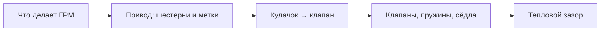
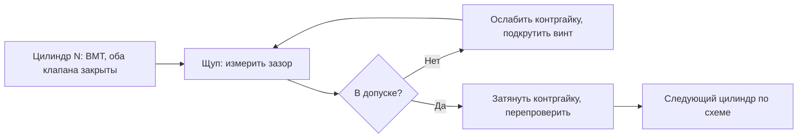

# День 12. Газораспределение: клапаны, распредвал, метки

> [!abstract] Зачем это слесарю-сборщику
> Помните 4 такта? Клапаны должны **открываться и закрываться в нужный момент**. За это отвечает механизм газораспределения (ГРМ). Если шестерни поставить «на зуб в сторону», двигатель не запустится или клапаны встретятся с поршнями. Сегодня разбираем, **как это устроено и где вы будете работать руками**.

## 🗺 Карта урока

## 🧩 Главное за 1 минуту
- **ГРМ** открывает **впускные** и **выпускные клапаны** в нужный момент цикла.
- Привод: **коленвал → шестерни → распредвал** (в тяжёлых дизелях часто **шестерённый привод**, а не ремень).
- **У ЯМЗ-240 шестерни распределения стоят сзади**, между блоком и маховиком (в картере маховика), а не спереди.
- На шестернях есть **метки**: их надо **совместить**. Это «момент синхронизации».
- Цепочка: **кулачок → толкатель → штанга → коромысло → клапан**.
- Между коромыслом и клапаном нужен **тепловой зазор**, потому что металл при нагреве расширяется.
- Зазор **регулируют** при установленном положении поршня и закрытом клапане.

---

## 🔍 1. Зачем всё это

Вспомните 4 такта: на впуске открыт **только впускной** клапан, на выпуске **только выпускной**, на сжатии и рабочем ходе **оба закрыты**. Открывает и закрывает их **распредвал** с «кулачками» (выступами).

> [!example] Аналогия
> Распредвал — **дирижёр**. Он говорит каждому клапану: «Сейчас открыться… теперь закрыться». Если дирижёр сбился, оркестр играет вразнобой.

Валов обычно **один на ряд** (два в V12) или **один в развале** блока. **У ЯМЗ-240 один распредвал в развале** (внутри блока), он открывает клапаны обоих рядов через толкатели и штанги. Скорость вращения распредвала **вдвое меньше** коленвала (клапан открывается раз в два оборота).

**Когда именно открываются клапаны** удобно показать на круге поворота коленвала. Это называется **фазы газораспределения**:

![[фазы_газораспределения.svg]]

---

## 🔍 2. Привод и метки

В больших дизелях часто стоит **шестерённый привод**: шестерни «зацеплены» друг с другом, без ремня и цепи.

> [!info] Где шестерни у ЯМЗ-240
> Не спереди, как у многих моторов, а **сзади**: на хвостовике коленвала, между задним торцом блока и маховиком, их закрывает картер маховика. На 3D-модели три шестерни: шестерня коленвала, промежуточная и шестерня распредвала; от этой же передачи крутится ТНВД. Сколько шестерён на настоящем моторе и где какие метки — **уточнить по ТК**.
>
> Что это значит для сборщика: шестерни ставят и метки совмещают **до установки картера маховика и маховика**. Потом метки уже не увидеть. На сайте: остановите анимацию, выберите вид «Сзади» и найдите момент, когда метки совпали.

![[метки_грм.svg]]

**Метки ГРМ** — это риски, точки или цифры на шестернях. При сборке **метки совмещают** по ТК: так ГРМ выставлено верно.

> [!warning] Всегда проверяйте метки дважды
> Один зуб неверно означает сдвиг фаз. Если метки не совпадают, **не затягивайте** и **не продолжайте**.

**Важные правила:**
1. Шестерни ставятся **строго по меткам**, указанным в ТК.
2. **Боковой зазор** в зацеплении проверяется щупом/индикатором.
3. Крепёж шестерён затягивается **моментом по ТК**, после чего проверяют **вращение вручную**.
4. **Коленвал и распредвал не вращаются** от руки «до упора» без причины: клапаны могут встретиться с поршнями (в зависимости от положения).

---

## 🔍 3. Кулачок → клапан

![[клапанный_механизм.svg]]

| Деталь | Что делает |
|---|---|
| **Кулачок** распредвала | Выступ, который толкает вверх |
| **Толкатель** | Приёмник движения от кулачка, ходит в направляющей |
| **Штанга** | Длинный стержень, передаёт движение к коромыслу |
| **Коромысло** | «Качели»: один конец вверх, другой вниз |
| **Регулировочный винт** | На коромысле: задаёт тепловой зазор |
| **Клапан** | «Дверь» в цилиндр |
| **Пружина клапана** | Возвращает клапан на место (закрывает) |
| **Сухари и тарелка** | Фиксируют пружину на стержне клапана |

> [!tip] Схема на пальцах
> Кулачок давит вверх → толкатель и штанга идут вверх → коромысло **качается** → другой конец идёт **вниз** и открывает клапан. Кулачок ушёл → пружина вернула клапан.

В некоторых двигателях (например, с верхним распредвалом) промежуточных деталей меньше: кулачок давит прямо на коромысло или толкатель.

---

## 🔍 4. Клапаны, сёдла, пружины

**Клапан:**
- **Тарелка** закрывает канал, садится на **седло** (кольцо в головке).
- **Стержень** ходит в **направляющей втулке**.
- Впускные и выпускные клапаны **различаются** (выпускные нагреваются сильнее, материал и размер отличаются).

**Типичные операции в сборке головки:**
1. Установить **направляющие втулки и сёдла** (чаще запрессованы заранее, проверяют).
2. Вставить **клапан**, смазав стержень чистым маслом.
3. Надеть **маслосъёмный колпачок** (уплотнитель на стержне).
4. Установить **пружину** (витки с меньшим шагом обычно ставят к головке; смотрите метку).
5. Надеть **тарелку** и установить **сухари** (разрезные конусы), сжимая пружину **специальным приспособлением**.
6. Проверить, что **сухари сели** (лёгкий удар пластиковым молотком по торцу стержня).

> [!warning] Не повредите колпачки и стержни
> Царапина на стержне или рваный колпачок означает расход масла и износ.

---

## 🔍 5. Тепловой зазор клапанов

При нагреве детали **расширяются**. Если клапан без зазора, при прогреве он может **не закрыться до конца** и потерять герметичность. Поэтому между коромыслом и стержнем клапана задают **небольшой зазор** (десятые доли мм `~пример: 0,25–0,40 мм`; **значения только из ТК**).

**Как регулируют (общий принцип):**
1. Провернуть коленвал так, чтобы **поршень нужного цилиндра** стоял в **ВМТ в такте сжатия** (клапаны этого цилиндра **закрыты**).
2. **Щупом** нужной толщины проверить зазор между коромыслом и клапаном.
3. Ослабить **контргайку** на винте, **вращая винт**, подобрать щуп «**с лёгким протягиванием**».
4. **Затянуть контргайку**, перепроверить.
5. Перейти к следующему цилиндру по **порядку работы** или по таблице-«схеме» из ТК.

> [!warning] Не перепутайте впуск и выпуск
> Зазоры впуска и выпуска **могут отличаться** (в ТК указаны отдельно).

---

## 🛠 На рабочем месте
- Метки ГРМ **обычно видны через люк** или при снятой крышке. Есть **шкала на шкиве/маховике** (градусы). У ЯМЗ-240 шестерни сзади, поэтому их метки совмещают, пока не поставлены картер маховика и маховик.
- Для проворота коленвала используют **специальный механизм** (вороток, провёртыватель) по ТК, не отвёрткой в венец!
- Регулировка зазоров делается **по таблице**: «если цилиндр 1 в ВМТ, регулируем клапаны таких-то цилиндров».

## ⚠ Типичные ошибки новичка
> [!warning] Чего избегать
> 1. **Сбить метки**, провернув вал «на глаз» после их выставления.
> 2. **Регулировать зазор на не закрытом клапане** (кулачок «давит»).
> 3. **Перепутать впускные и выпускные** клапаны.
> 4. **Забыть затянуть контргайку** или не перепроверить после затяжки.
> 5. **Повредить маслосъёмные колпачки.**
> 6. **Провернуть вал «до упора»**, когда клапаны могут встретиться с поршнем.

## 🔀 У вашего мотора может быть иначе
| Что | Варианты |
|---|---|
| Привод | Шестерни / цепь / ремень |
| Где шестерни привода | Спереди / сзади (у ЯМЗ-240 сзади, между блоком и маховиком) |
| Распредвал | В блоке (штанги) / верхний (в головке). У ЯМЗ-240 один в развале блока |
| Клапанов на цилиндр | 2 / 4 |
| Регулировка зазора | Винты и контргайки / гидрокомпенсаторы / шайбы |
| Декомпрессионный механизм | Есть / нет |
| Привод ТНВД | От того же ГРМ |

## 📷 Фото-задание
Сфотографируйте **шестерни ГРМ с метками**, **коромысла с регулировочными винтами**, **клапаны в сборе** (пружина, тарелка, сухари).

## ✅ Самопроверка
> [!question]- 1. Что делает ГРМ?
> - [ ] Подаёт топливо в цилиндры
> - [x] Открывает и закрывает клапаны в нужные моменты цикла
> - [ ] Поджигает топливо
> - [ ] Охлаждает головки
>
> Открывает и закрывает клапаны в нужные моменты цикла.

> [!question]- 2. Почему распредвал вращается вдвое медленнее коленвала?
> - [x] Клапан открывается один раз за цикл, а цикл — два оборота коленвала
> - [ ] Чтобы распредвал меньше изнашивался
> - [ ] Так проще изготовить шестерни
> - [ ] Чтобы двигатель работал тише
>
> Клапан должен открыться один раз за полный цикл (два оборота коленвала).

> [!question]- 3. Зачем нужны метки на шестернях?
> - [ ] Для учёта пробега
> - [ ] Показывают направление потока масла
> - [ ] Для балансировки шестерён
> - [x] Для правильной синхронизации распредвала и коленвала
>
> Для правильной синхронизации распредвала и коленвала.

> [!question]- 4. Что такое тепловой зазор?
> - [ ] Зазор между поршнем и гильзой
> - [ ] Зазор в замке поршневого кольца
> - [x] Промежуток между коромыслом и клапаном на расширение металла при нагреве
> - [ ] Расстояние от клапана до поршня
>
> Небольшой промежуток между коромыслом и клапаном, учитывающий расширение металла при нагреве.

> [!question]- 5. В каком положении регулируют зазор клапана?
> - [ ] Клапан полностью открыт
> - [x] Клапан закрыт, поршень в ВМТ такта сжатия (по схеме из ТК)
> - [ ] Поршень в НМТ такта выпуска
> - [ ] На работающем двигателе
>
> Когда клапан закрыт, а поршень соответствующего цилиндра в ВМТ такта сжатия (по схеме из ТК).

> [!question]- 6. Чем впускной клапан отличается от выпускного?
> - [x] Размером и материалом: выпускной сильнее греется, путать нельзя
> - [ ] Ничем, они взаимозаменяемы
> - [ ] Только цветом
> - [ ] Только длиной пружины
>
> Размером и материалом (выпускной сильнее нагревается), их нельзя путать.

## ❓ 3 вопроса наставнику
1. Сколько шестерён в заднем приводе распределения и где на них метки?
2. Какие значения зазоров впуска и выпуска по нашим ТК?
3. Как мы безопасно проворачиваем коленвал при регулировке?

## 📚 Термины
[[Глоссарий/Клапан]] · [[Глоссарий/Распредвал]] · [[Глоссарий/Толкатель]] · [[Глоссарий/Коромысло]] · [[Глоссарий/Тепловой зазор]] · [[Глоссарий/Метки ГРМ]] · [[Глоссарий/Щуп]]

## ➡ Дальше
[[05_Топливная_система]]
