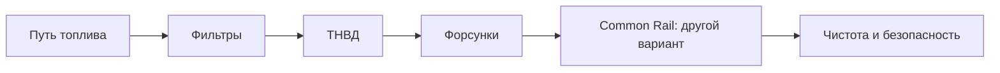

# День 12. Топливная система: от бака до форсунки

> [!abstract] Зачем это слесарю-сборщику
> Топливная аппаратура дизеля — самая **«ювелирная»** часть. Детали подогнаны с точностью в **микроны**, загрязнение в доли миллиметра выводит узел из строя. Ваша задача: **чистота, аккуратность, правильная затяжка и безопасность** (струя топлива под давлением опасна).

## 🗺 Карта урока

## 🧩 Главное за 1 минуту
- Топливо проходит: **бак → фильтры → подкачка → ТНВД → трубки → форсунки → цилиндры**.
- **Низкое давление**: подача и очистка. **Высокое давление**: насос + форсунки.
- **ТНВД** создаёт высокое давление и определяет, **когда и сколько** впрыснуть.
- **Форсунка** распыляет топливо в цилиндре.
- **Прецизионные пары** (плунжер–втулка, игла–распылитель) подобраны **комплектом**: нельзя менять местами и нельзя трогать острыми предметами.
- **Чистота**: ни пылинки. Всё закрыто заглушками, пока не нужно.
- Топливо под высоким давлением **может проникнуть под кожу**: **никогда** не проверять утечки рукой.

---

## 🔍 1. Путь топлива

![[топливо_путь.svg]]

| Узел | Что делает | Что важно сборщику |
|---|---|---|
| **Бак** | Хранит топливо | Чистый, без осадка |
| **Фильтр грубой очистки** | Удаляет крупные частицы и воду | Правильное направление потока (стрелка) |
| **Подкачивающий насос** | Подаёт топливо к ТНВД под небольшим давлением | Герметичность соединений |
| **Фильтр тонкой очистки** | Удаляет мельчайшие частицы | Новый фильтр, правильная установка |
| **ТНВД** | Создаёт высокое давление, дозирует и распределяет топливо | Чистота, метки, правильная установка |
| **Трубки высокого давления** | Соединяют ТНВД и форсунки | Нельзя гнуть и перепутать, затягивать по моменту |
| **Форсунки** | Распыляют топливо в цилиндре | Чистота, уплотнительные шайбы, момент |
| **Обратная магистраль** | Возвращает излишки в бак | Не перекрывать |

---

## 🔍 2. ТНВД

**ТНВД** — «сердце» топливной системы. Он:
- **сжимает** топливо до высокого давления,
- **дозирует** количество (больше нагрузка — больше топлива),
- **подаёт в нужный момент** (в конце такта сжатия).

**Секционный ТНВД** (классика для больших дизелей): на **каждый цилиндр свой плунжерный насос (секция)** в одном корпусе. У V12 это часто два насоса (по одному на ряд) или один сдвоенный. Привод от коленчатого вала через шестерни (синхронно с ГРМ).

**Типичная секция** (поршень насоса):
- **плунжер** ходит в **втулке** (пара с микронным зазором),
- **нагнетательный клапан** (пропускает топливо к форсунке, не даёт обратного потока),
- рейка/механизм регулирует **подачу**.

> [!warning] Не трогать «прецизионные пары»
> Плунжер и втулка подобраны **друг к другу** на заводе. Поменять местами означает **убить насос**. Если разобрали, **раскладывайте по секциям** и не смешивайте.

**Угол опережения впрыска:** топливо нужно впрыснуть **чуть до ВМТ**, чтобы оно успело воспламениться и сгореть. Его выставляют по **меткам/шкале** при установке насоса (по ТК).

---

## 🔍 3. Форсунка

**Форсунка** открывается, когда давление топлива достигает **заданного** (давление начала впрыска `~пример: десятки МПа`), и распыляет его **мельчайшими каплями**.

**Устройство (упрощённо):**

![[форсунка_разрез.svg]]
- **корпус**,
- **распылитель** (сопло с несколькими микроотверстиями),
- **игла** с пружиной, запирающая сопло,
- **регулировочные шайбы/винт** (задают давление открытия).

> [!warning] Правила с форсункой
> 1. **Не прочищать отверстия** иглами и проволокой. Это испортит распыл.
> 2. **Не ронять**, не бить, не царапать носик.
> 3. **Уплотнительные шайбы** (медные/стальные) **одноразовые**: ставить новые по ТК.
> 4. **Момент затяжки** форсунки задан, не перетягивать (деформируется корпус).
> 5. Устанавливать **в чистое гнездо**, без остатков нагара и мусора.

---

## 🔍 4. Common Rail: другой вариант

В **Common Rail** (общая рампа):
- **один насос высокого давления** создаёт давление в **общей «трубе» (рампе)**,
- **форсунки** подключены к ней и **открываются электроникой** (электромагнитные/пьезо),
- давление может быть **очень высоким** (сотни МПа, `~пример`),
- есть **датчики** и **электронный блок управления**.

| | Секционный ТНВД | Common Rail |
|---|---|---|
| Давление | Зависит от оборотов | Постоянное, регулируется |
| Управление | Механика/механическая рейка | Электроника |
| Сборщику | Метки, угол опережения, прецизионные пары | Чистота, электроразъёмы, датчики, **очень высокое давление** |

---

## 🔍 5. Прокачка и безопасность

**Прокачка (удаление воздуха)**: после сборки или замены фильтров воздух надо вытеснить, иначе двигатель не запустится. Для этого есть **ручной подкачивающий насос** и **винты/штуцеры прокачки**.

> [!warning] ОПАСНО: струя высокого давления
> - **Никогда** не проверять течь **рукой**. Струя может **проникнуть под кожу**: это тяжёлая травма.
> - **Не отворачивать** штуцеры, **пока в системе есть давление**.
> - Работать в **очках**, при возможности через картонку/бумагу.
> - Любой контакт с топливом под давлением **это повод немедленно к врачу**.

**Чистота (правило «операционной»):**
- Пока не нужно, **все штуцеры и отверстия закрыты заглушками**.
- **Не протирать** ветошью с ворсом.
- Инструмент и руки **чистые**.
- После отсоединения трубок **сразу ставьте колпачки**.

---

## 🛠 На рабочем месте
- Топливную аппаратуру **часто собирают в отдельной чистой зоне**.
- ТНВД и форсунки обычно приходят **проверенными и отрегулированными** (после стенда). Вы их **устанавливаете** и **подключаете**.
- Трубки высокого давления **нумеруются** (цилиндр/секция): ставьте строго по номерам.
- Моменты на штуцерах и гайках трубок **небольшие и важные**: перетяг деформирует «конус» уплотнения.

## ⚠ Типичные ошибки новичка
> [!warning] Чего избегать
> 1. **Грязь** на штуцерах, в гнёздах форсунок.
> 2. **Перепутанные трубки** (цилиндр N → форсунка M).
> 3. **Перетянутые** штуцеры (течь/трещина).
> 4. **Старая уплотнительная шайба** под форсункой.
> 5. **Остался воздух** в системе (не прокачали).
> 6. **Проверка течи рукой.**
> 7. **Ронять и бить** форсунки.
> 8. **Подгибать трубки** «чтобы подошли».

## 🔀 У вашего мотора может быть иначе
| Что | Варианты |
|---|---|
| Топливный насос | Секционный (по секции на цилиндр) / распределительный / Common Rail |
| Форсунки | Механические / электромагнитные / пьезо / насос-форсунки |
| Фильтры | 1 или 2 ступени, с подогревом, с датчиком воды |
| Привод насоса | Шестерни от ГРМ / отдельный привод |
| Управление подачей | Рейка и регулятор / электроника |

## 📷 Фото-задание
Сфотографируйте **ТНВД, форсунку, трубку высокого давления, фильтр** и их **маркировку/номера**. Если есть схема топливной системы на участке, сфотографируйте тоже.

## ✅ Самопроверка
> [!question]- 1. Что делает ТНВД?
> - [ ] Подкачивает топливо из бака к фильтру
> - [x] Создаёт высокое давление, дозирует и подаёт топливо в нужный момент
> - [ ] Распыляет топливо в цилиндре
> - [ ] Охлаждает топливо
>
> Создаёт высокое давление топлива, дозирует и подаёт в нужный момент.

> [!question]- 2. Зачем нужна форсунка?
> - [x] Распыляет топливо мелкими каплями в цилиндре
> - [ ] Создаёт высокое давление
> - [ ] Очищает топливо
> - [ ] Возвращает лишнее топливо в бак
>
> Распыляет топливо мелкими каплями в цилиндре.

> [!question]- 3. Что такое прецизионная пара?
> - [ ] Две одинаковые форсунки на один цилиндр
> - [ ] Пара болтов крепления насоса
> - [ ] Две шайбы поворотного штуцера
> - [x] Две детали с микронным зазором, меняются только комплектом
>
> Две детали, подогнанные друг к другу микронным зазором (плунжер и втулка, игла и распылитель). Заменяются только комплектом.

> [!question]- 4. Почему нельзя прочищать сопло иглой?
> - [ ] Игла сломается
> - [ ] Можно, если игла тонкая
> - [x] Испортится форма отверстий и качество распыла
> - [ ] Сопло заржавеет
>
> Испортится форма отверстий и качество распыла.

> [!question]- 5. Чем опасна струя топлива под давлением?
> - [ ] Только пачкает одежду
> - [x] Может проникнуть под кожу и вызвать тяжёлую травму
> - [ ] Опасна только возгоранием
> - [ ] В перчатках не опасна
>
> Может проникнуть под кожу и вызвать тяжёлую травму.

> [!question]- 6. Что такое прокачка?
> - [x] Удаление воздуха из топливной системы
> - [ ] Промывка бака
> - [ ] Проверка давления масла
> - [ ] Регулировка угла опережения впрыска
>
> Удаление воздуха из топливной системы после сборки/замены деталей.

> [!question]- 7. Чем Common Rail отличается от секционного ТНВД?
> - [ ] У каждого цилиндра свой насос
> - [ ] Работает без форсунок
> - [ ] Работает на низком давлении
> - [x] Один насос держит давление в общей рампе, форсунками управляет электроника
>
> Один насос создаёт давление в общей рампе, форсунки управляются электроникой.

## ❓ 3 вопроса наставнику
1. Какая у нас топливная система (секционная или Common Rail)?
2. Как у нас маркируются трубки высокого давления и форсунки?
3. Какие требования к чистоте и какие заглушки использовать?

## 📚 Термины
[[Глоссарий/ТНВД]] · [[Глоссарий/Форсунка]] · [[Глоссарий/Распылитель]] · [[Глоссарий/Прецизионная пара]] · [[Глоссарий/Топливный фильтр]] · [[Глоссарий/Common Rail]] · [[Глоссарий/Прокачка]]

## ➡ Дальше
[[06_Смазка_охлаждение_воздух_выпуск]]
