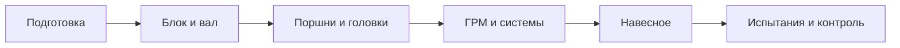
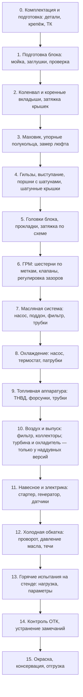
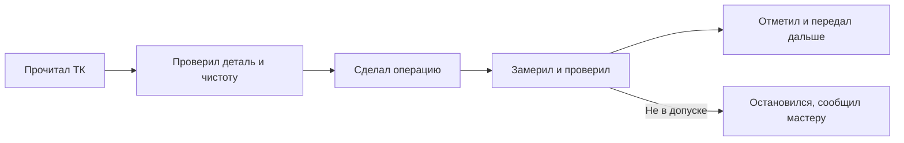

# День 14. Сквозной маршрут сборки V12

> [!abstract] Зачем это слесарю-сборщику
> Вы изучили детали по отдельности. Сегодня соберём **общую картину**: в какой последовательности собирают двигатель, **что проверяют на каждом этапе** и **какие документы заполняют**. Когда понимаешь «весь путь», отдельные операции перестают казаться набором случайных действий.

> [!warning] Оговорка
> Это **типовой** маршрут для большого V-образного дизеля. **Реальный порядок** (и деление на участки) определяется технологическим процессом вашего завода. Всегда следуйте ТК.

## 🗺 Карта урока

## 🧩 Главное за 1 минуту
- Двигатель собирают **от «скелета» к «навесному»**: блок → вал → поршни → головки → ГРМ → системы → навесное.
- На **каждом этапе** есть **контрольные точки**: проверки, замеры, подписи.
- **Чистота** и **порядок** важнее скорости.
- После сборки идут **холодная обкатка**, **горячие испытания**, **контроль ОТК**, **консервация**.
- Любое отклонение (забоина, не попал в допуск, перепутали деталь) **означает остановку и сообщение мастеру**.

---

## 🔍 1. Весь маршрут на одной схеме

> [!info] Как это выглядит у ЯМЗ-240М2
> У ЯМЗ-240 **шестерни распределения стоят сзади**, между блоком и маховиком. Поэтому маховик нельзя ставить раньше шестерён: сначала распредвал и шестерни по меткам (этап 6), потом картер маховика и маховик. То есть маховик (этап 3) ставят уже после шестерён (этап 6). Так же собрано на сайте в разделе «Сборка». Турбины и охладителя наддувочного воздуха у 240М2 **нет** (они есть у ЯМЗ-240НМ2). Точный порядок — **по ТК завода**.

---

## 🔍 2. Этапы и ключевые проверки

| № | Этап | Что делают | Ключевая проверка | Документ/отметка |
|---|---|---|---|---|
| 0 | Подготовка | Получают детали и крепёж, читают ТК | Комплектность, версии ТК, чистота | Накладная/карта комплектации |
| 1 | Блок | Осмотр, заглушки, установка на стенд | Нет трещин/забоин, каналы чистые | Отметка в карте |
| 2 | Коленвал | Вкладыши, вал, крышки, затяжка | **Свободное вращение** после каждой крышки, осевой люфт | Подпись, замеры |
| 3 | Маховик | Установка, затяжка | Биение торца | Замеры |
| 4 | Гильзы и поршни | Установка, кольца, шатуны | **Выступание гильз**, замковые зазоры, ориентация поршней | Замеры, подпись |
| 5 | Головки | Прокладки, затяжка | **Порядок затяжки**, момент | Подпись, ОТК (по ТК) |
| 6 | ГРМ | Шестерни, клапаны | **Метки совмещены**, зазоры клапанов | Замеры |
| 7 | Масло | Насос, поддон, фильтр | Герметичность, чистота | Отметка |
| 8 | Охлаждение | Насос, термостат, патрубки | Герметичность, хомуты | Отметка |
| 9 | Топливо | ТНВД, форсунки, трубки | Чистота, **номера трубок**, угол опережения | Подпись, ОТК |
| 10 | Воздух/выпуск | Воздушный фильтр, коллекторы (турбина — только у наддувных версий) | Нет посторонних предметов, прокладки | Отметка |
| 11 | Навесное | Стартер, генератор, датчики | Комплектность, подключения | Отметка |
| 12 | Холодная обкатка | Прокрутка без топлива | **Давление масла**, течи, шумы | Протокол |
| 13 | Горячие испытания | Запуск, нагрузка на стенде | Параметры (давление, температура, мощность) | Протокол испытаний |
| 14 | Контроль ОТК | Приёмка | Соответствие чертежу, ТК | Паспорт/акт |
| 15 | Консервация | Окраска, защита, упаковка | Заглушки, пломбы | Отметка |

---

## 🔍 3. Что такое обкатка и испытания (простыми словами)

**Холодная обкатка.** Двигатель **проворачивают** внешним приводом (электромотор) **без топлива**: видят, что **масло пошло**, **нет заеданий**, **нет течей**, нет посторонних шумов.

**Горячие испытания.** Запускают на **стенде** и дают **нагрузку** по программе. Контролируют:
- давление масла и его температуру,
- температуру охлаждающей жидкости,
- давление наддува (только у наддувных версий, у 240М2 его нет),
- расход топлива,
- мощность и момент,
- дымность и шум,
- **течи** масла, воды, топлива.

> [!example] Аналогия
> Это «медосмотр двигателя»: сначала проверяют сердце без нагрузки (проворот), потом под нагрузкой (стенд).

Если на испытаниях что-то не так (низкое давление масла, стук, течь), двигатель **возвращают на участок** для устранения. **Часто причина в сборке**: недотянутый болт, неправильно поставленный вкладыш, воздух в топливе.

---

## 🔍 4. Правила, которые работают на любом этапе

1. **Читай ТК перед каждой операцией.** Даже если «делал вчера».
2. **Осмотри деталь**: чистота, повреждения, маркировка.
3. **Сделай операцию в заданном порядке.**
4. **Проверь** (замер, щуп, вращение).
5. **Отметь** выполнение (подпись, метка).
6. **Не в допуске?** Остановка и сообщение.
7. **Закрывай** открытые каналы и узлы заглушками.
8. **Оставляй рабочее место чистым.**

---

## 🛠 На рабочем месте
- Двигатель собирается на **постах** (линейно) или на **одном стенде** (стационарно). Детали подвозят.
- **Карта сборки** (маршрутный лист) **путешествует вместе с двигателем**: туда пишут отметки, замеры, подписи.
- **Номер двигателя** выбивается на блоке, он связывает все документы.
- В конце смены **передают двигатель** следующей смене, **рассказывая, что сделано** и где остановились.

## ⚠ Типичные ошибки новичка
> [!warning] Чего избегать
> 1. **Забыть отметку** в карте (потом не докажете, что делали).
> 2. **Пропустить замер**, «потому что и так нормально».
> 3. **Оставить открытым** канал или штуцер.
> 4. **Не передать информацию** следующей смене (где остановился, что не закончено).
> 5. **Работать «по порядку в голове»**, а не по ТК.
> 6. **Скрыть ошибку**, а не сообщить сразу. Скрытый дефект оборачивается поломкой на стенде или у заказчика.

## 🔀 У вашего завода может быть иначе
- Другая **последовательность** (например, головки собирают отдельно и ставят готовыми).
- Разделение на **участки и бригады** (блок, КШМ, головки, топливо, навесное, испытания).
- Электронная **карта сборки** вместо бумажной.
- Свои **этапы контроля** (после каждой операции или в конце).

## 📷 Фото-задание
Если разрешено, сфотографируйте **схему маршрута** на участке (если есть), **карту сборки** (закрыв личные данные), **номер двигателя на блоке**.

## ✅ Самопроверка
> [!question]- 1. Назовите порядок: блок, вал, головки, поршни.
> Блок → вал → поршни (с гильзами и шатунами) → головки.

> [!question]- 2. Зачем делают холодную обкатку?
> Проверить давление масла, отсутствие заеданий и течей без запуска на топливе.

> [!question]- 3. Что проверяют после затяжки каждой крышки коренного подшипника?
> Свободное вращение коленвала.

> [!question]- 4. Что такое карта сборки?
> Документ, который сопровождает двигатель: операции, замеры, подписи.

> [!question]- 5. Что делать, если замер не в допуске?
> Остановиться и сообщить мастеру.

> [!question]- 6. Зачем закрывать каналы заглушками?
> Чтобы не попала грязь или посторонние предметы.

> [!question]- 7. Кто окончательно принимает двигатель?
> ОТК после испытаний.

## ❓ 3 вопроса наставнику
1. Какой у нас технологический маршрут и на каком посту/участке буду работать я?
2. Какие замеры и отметки обязательны на моём этапе?
3. Что делать, если на испытаниях нашли дефект на моей операции?

## 📚 Термины
[[Глоссарий/Технологическая карта]] · [[Глоссарий/ОТК]] · [[Глоссарий/Обкатка]] · [[Глоссарий/Консервация]] · [[Глоссарий/Момент затяжки]]

## ➡ Дальше
Вы прошли основной курс. Сделайте повтор по [[00_План_курса]]: пройдите самопроверки всех уроков ещё раз. Практические материалы (чек-лист первой смены, итоговый тест) пока в работе, см. раздел «Статус» в плане.
