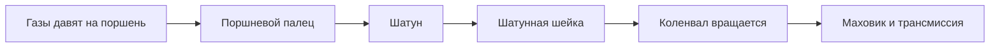

# Кривошипно-шатунный механизм (КШМ)

> [!abstract] Коротко
> КШМ превращает толчки газов на поршни во вращение вала. Это самый нагруженный и самый точный узел двигателя: здесь масляные зазоры в сотые доли миллиметра и самые ответственные болты. Ниже — что это, зачем, как работает, где стоит в ЯМЗ-240М2 и как его собирают по шагам.

> [!info] Как читать этот разбор
> Каждый 3D-блок листается кнопками шагов под ним. В полноэкранном режиме модель можно приближать и крутить. В шагах сборки детали этого шага подлетают на своё место; пауза останавливает их уже на месте. Числа (моменты, зазоры, углы) намеренно не даются: на заводе их берут только из [[Глоссарий/Технологическая карта|технологической карты]].

## 🧩 Что это такое — простыми словами

Вспомните велосипед. Нога давит на педаль вниз — звёздочка крутится. Нога ходит вверх-вниз, а колесо вращается. В двигателе то же самое:

- **поршень** — это нога: его толкают вниз раскалённые газы;
- **шатун** — это голень: он передаёт толчок дальше;
- **коленчатый вал** — это педаль со звёздочкой: «колено» вала (кривошип) превращает толчок во вращение.

Всё вместе — **кривошипно-шатунный механизм**, сокращённо **КШМ**. В двигателе ЯМЗ-240М2 двенадцать поршней и шатунов работают на один коленчатый вал.

## 🎯 Зачем он нужен

1. **Превратить давление газов во вращение.** Без КШМ сгорание топлива просто нагревало бы цилиндр.
2. **Собрать работу двенадцати цилиндров в один вал.** Цилиндры вспыхивают по очереди, вал получает толчки равномерно и отдаёт вращение на маховик, а дальше — в трансмиссию.
3. **Вернуть поршень обратно.** На тактах впуска, сжатия и выпуска поршень двигает уже сам вал — за счёт инерции маховика и толчков других цилиндров.
4. **Выдержать огромные силы.** При вспышке на поршень давят газы с силой в несколько тонн. Её принимают палец, шатун, вкладыши, вал и крышки коренных подшипников.

## 🔩 Из чего состоит

| Деталь | Что делает | Где стоит | Главное при сборке |
|---|---|---|---|
| [[Глоссарий/Коленчатый вал]] | Принимает толчки всех шатунов и вращается | Внизу блока, на семи коренных опорах | Чистые шейки и каналы, опускать краном без удара |
| Коренные [[Глоссарий/Вкладыш\|вкладыши]] | Тонкие полукольца-подшипники между валом и блоком | В постелях блока и в крышках | «Усик» в паз, отверстие против канала, тыльная сторона сухая |
| Крышки [[Глоссарий/Коренной подшипник\|коренных подшипников]] | Держат вал снизу | Под каждой коренной шейкой | Только на своё место и своей стороной; у ЯМЗ-240 по 4 болта |
| Упорные полукольца | Не дают валу сдвигаться вдоль оси | У средней коренной опоры | Канавками к щекам вала |
| [[Глоссарий/Шатун]] | Передаёт силу от поршня к валу | Между поршнем и шатунной шейкой | Номер шатуна = номер цилиндра |
| Крышка шатуна с болтами | Охватывает шатунную шейку снизу | На нижней головке шатуна | Метки крышки и шатуна совпадают; болты часто одноразовые |
| Шатунные вкладыши | Подшипник между шатуном и шейкой | В нижней головке шатуна и крышке | Как у коренных: усик, чистота, смазка |
| [[Глоссарий/Поршень]] | Принимает давление газов | В гильзе цилиндра | Метка направления по ТК |
| [[Глоссарий/Поршневое кольцо\|Поршневые кольца]] | Держат газы и снимают лишнее масло | В канавках поршня | Метка «TOP» вверх, замки разведены |
| Поршневой палец и стопорные кольца | Соединяет поршень с шатуном | В бобышках поршня и втулке шатуна | Оба стопорных кольца в канавках |
| [[Глоссарий/Маховик]] | Сглаживает вращение, несёт венец для стартера | На заднем фланце вала | По штифтам, момент по ТК, проверка биения |
| Гаситель крутильных колебаний | Гасит закручивание длинного вала | На переднем носке вала | По шпонке или штифту |
| [[Глоссарий/Манжета\|Манжеты]] коленвала | Не выпускают масло там, где вал выходит из блока | Спереди и сзади | Кромкой к маслу, запрессовка оправкой |

## 📍 Где стоит в двигателе ЯМЗ-240М2

КШМ занимает **нижнюю половину блока** и сами цилиндры. Коленвал лежит вдоль двигателя: спереди на нём гаситель колебаний и шкив, сзади — шестерня распределения, за ней фланец с маховиком. Над валом, в два ряда под углом 90°, стоят двенадцать гильз с поршнями.

- **Коренных опор семь**, шатунных шеек — **шесть**. На каждой шатунной шейке рядом сидят **два шатуна**: по одному из каждого ряда. Пары цилиндров: 1–7, 2–8, 3–9, 4–10, 5–11, 6–12.
- **Нумерация** цилиндров — от переднего торца: один ряд 1–6, второй 7–12.
- **Крышки коренных** у ЯМЗ-240 крепятся четырьмя болтами: двумя вертикальными и двумя горизонтальными стяжными (через стенки картера в бока крышки).

```3d
g-kshm-where
```

## ⚙️ Как работает

Один цилиндр за полный цикл (два оборота вала) проходит четыре такта. Работу даёт только **рабочий ход**: газы толкают поршень вниз. Остальные три такта поршень двигает сам вал.



**Три вещи, которые надо понимать сборщику:**

1. **Вал не касается вкладышей металлом.** Между шейкой и вкладышем — **масляная плёнка** толщиной в сотые доли миллиметра. Масло приходит под давлением через отверстия во вкладышах и сверления вала. Поэтому важны чистота, совпадение отверстий и правильный зазор: грязь или сухой запуск — и вкладыш задирается за минуты.
2. **Силы меняют направление.** На рабочем ходе шатун сжат, в верхней точке такта выпуска его, наоборот, растягивает инерция поршня. Растяжение держат болты крышки шатуна — поэтому они самые ответственные в двигателе.
3. **Вспышки идут неравномерно: поочерёдно через 90° и 30°.** Это следствие развала 90° и того, что два шатуна сидят на одной шейке. Гаситель колебаний на переднем конце вала гасит закручивание длинного вала от таких толчков.

> [!example] Почему два шатуна на одной шейке
> Так вал получается короче и жёстче: шесть шеек вместо двенадцати. Цилиндры двух рядов смещены вдоль вала ровно на толщину шатуна — поэтому ряды стоят не точно напротив друг друга.

## 🔍 Детали поближе

### Коленчатый вал: шейки и каналы

Вал — одна стальная поковка. **Коренные шейки** лежат на одной оси и вращаются во вкладышах блока. **Шатунные шейки** смещены от оси — это и есть «колени». **Щёки** соединяют шейки, **противовесы** на щеках уравновешивают вращающиеся массы. Внутри вала просверлены **каналы**: масло из коренной шейки идёт по ним к шатунной.

```3d
crank-journals
```

### Вкладыши: как ставятся

Вкладыш — тонкая стальная лента, изогнутая полукольцом, с антифрикционным слоем внутри. Две половины образуют подшипник. На каждой половине есть **усик** — выступ, который входит в паз постели и не даёт вкладышу провернуться. Половина с **отверстием и канавкой** ставится туда, где из блока приходит масло.

```3d
bearing-shell
```

> [!warning] Тыльная сторона — сухая
> Под вкладыш масло не наносят: он должен плотно сидеть в постели. Смазывают только **рабочую** сторону, по которой бежит шейка. Вкладыши не подпиливают и не подгоняют.

### Поршень, кольца и установка в гильзу

Кольца: два компрессионных сверху (держат газы) и маслосъёмное ниже (снимает масло со стенки гильзы). Метка «TOP» — вверх, замки разведены по схеме ТК. Поршень вводят в гильзу через **обжимку** колец, мягкими толчками деревянной рукоятки — последний шаг блока ниже.

```3d
piston-rings
```

## 🛠 Как собирают: по шагам

Сборку КШМ делают на **поворотном стенде**: блок закрепляют и переворачивают постелями вверх, чтобы удобно уложить вал. Ниже — типовой порядок по маршруту курса. **Точный порядок, моменты, углы и замеры — только по ТК вашего завода.**

### Перед началом

- **Комплектация.** Все детали по карте сборки: номер блока, номер вала, размерные группы вкладышей, поршней и колец, номера шатунов. Детали из разных групп не смешивают.
- **Чистота.** Блок вымыт, каналы продуты и проверены, заглушки на месте. Детали КШМ промыты и разложены на чистом столе. Руки и перчатки чистые, ветошь — безворсовая.
- **Инструмент.** Поверенный [[Глоссарий/Динамометрический ключ|динамометрический ключ]], угломер, [[Глоссарий/Индикатор часового типа|индикатор]] на магнитной стойке, [[Глоссарий/Щуп|щупы]], обжимка колец, щипцы для колец, мягкие стропы, монтировка из мягкого металла, чистое масло.

### Шаги

1. **Верхние вкладыши в постели.** Постели протирают насухо. Вкладыш вставляют усиком в паз, отверстие — против масляного канала. Рабочую сторону смазывают маслом по ТК.
   *Контроль:* отверстия совпали с каналами, вкладыш сидит заподлицо и не болтается.
2. **Коленвал.** Шейки осматривают (нет забоин, рисок), каналы продувают. Вал поднимают краном на **мягких стропах** и опускают ровно, без удара шейками о блок.
   *Контроль:* вал лёг на все опоры, проворачивается рукой.
3. **Упорные полукольца.** Их заводят в проточку у средней опоры **канавками к щекам вала**.
   *Контроль:* полукольца не выступают над постелью.
4. **Крышки коренных подшипников.** Нижние вкладыши — в крышки, смазать. Каждую крышку ставят на **своё** место по номеру и **своей** стороной по стрелке: крышки растачивали вместе с блоком.
   *Контроль:* номер и стрелка совпадают с меткой на блоке.
5. **Затяжка крышек.** От **средней крышки к краям**, у каждой — оба вертикальных болта поочерёдно, в несколько проходов (предварительно, окончательно, доворот на угол — по ТК). Потом горизонтальные стяжные. **После каждой крышки вал проворачивают рукой.**
   *Контроль:* вращение свободное. Стал туго — остановиться и позвать мастера: возможно, перепутаны вкладыши, грязь или крышка не той стороной.
6. **Осевой люфт вала.** Индикатор упирают в торец вала, вал отжимают монтировкой в одну и в другую сторону.
   *Контроль:* люфт в допуске ТК, значение записано в карту.
7. **Манжеты и гаситель.** Манжеты запрессовывают оправкой, кромкой к маслу, кромку смазывают. Гаситель ставят на передний носок по шпонке или штифту.
8. **Гильзы.** Мокрые гильзы ставят с новыми резиновыми кольцами, смазанными составом по ТК, ровно, без перекоса. Затем меряют **[[Глоссарий/Выступание гильзы|выступание]]** каждой гильзы над блоком индикатором.
   *Контроль:* выступание в допуске, записано.
9. **Поршни с шатунами.** Номер шатуна = номер цилиндра. На кольцах метки «TOP» вверх, замки разведены. Гильзу, поршень и кольца смазывают. Кольца сжимают обжимкой, поршень — меткой по ТК — вводят в гильзу мягкими толчками рукоятки. Шейку вала ставят в нижнюю точку, на болты шатуна надевают защитные колпачки, чтобы не поцарапать шейку.
   *Контроль:* поршень вошёл без удара. Если не идёт — кольцо выскочило из обжимки: остановиться.
10. **Крышки шатунов.** Вкладыш — в крышку, смазать. Крышку ставят **метками в одну сторону** с шатуном. Болты (новые, если ТК требует) тянут поочерёдно моментом и доворотом на угол, ставят метку маркером.
    *Контроль:* боковой зазор шатуна на шейке — щупом; вал проворачивается.
11. **Проворот.** Вал с поршнями проворачивают на полные обороты рукой или приспособлением.
    *Контроль:* ход ровный, без заеданий и стуков. Маховик ставят позже, после шестерён распределения (см. [[02_Разбор_ГРМ]]).

```3d
g-kshm-assembly
```

## 📏 Какие замеры делают

| Замер | Чем | Когда | Зачем |
|---|---|---|---|
| Масляный зазор во вкладышах | [[Глоссарий/Нутромер]] (диаметр постели с вкладышами) и [[Глоссарий/Микрометр]] (диаметр шейки) — разница; иногда пластиковый калибр, если разрешает ТК | Перед окончательной сборкой | Мало — нет плёнки, задир; много — падает давление масла, стук |
| Осевой люфт коленвала | Индикатор у торца вала | После затяжки крышек | Проверить упорные полукольца |
| Боковой зазор шатуна | Щуп между шатунами или шатуном и щекой | После затяжки крышек шатунов | Шатун не зажат на шейке |
| Замковый зазор колец | Щуп, кольцо ровно в гильзе | До установки колец на поршень | Мало — кольцо при нагреве сомкнёт замок и сломается |
| Выступание гильз | Индикатор на стойке | После установки гильз | От него зависит прижатие прокладки головки |
| Торцевое биение маховика | Индикатор | После затяжки маховика | Ровная работа сцепления |
| Момент и угол затяжки | Динамометрический ключ и угломер | На каждом резьбовом соединении | Нужная сила прижатия |

Все значения записывают в **карту сборки**: по ним ОТК и мастер проверяют работу, а при дефекте на испытаниях — ищут причину.

## ⚠ Типичные ошибки и к чему они приводят

> [!warning] Ошибки в КШМ — самые дорогие
> 1. **Перепутать крышки коренных** местами или поставить задом наперёд → ступенька в постели, вал заклинит.
> 2. **Смазать тыльную сторону вкладыша** → вкладыш провернётся, перекроет масло.
> 3. **Вкладыш с отверстием не на том месте** → масло не дойдёт до шейки, задир.
> 4. **Не продуть каналы вала и блока** → стружка уйдёт прямо во вкладыши.
> 5. **Поставить старые одноразовые болты шатуна** → обрыв болта, шатун пробивает блок.
> 6. **Кольца вверх ногами или замки в одну линию** → расход масла, прорыв газов.
> 7. **Забивать поршень молотком** → сломанное кольцо, задир гильзы.
> 8. **Не проверить вращение вала** после каждой крышки → заедание найдут только на обкатке, двигатель разбирать заново.

## ✅ Как понять, что всё сделано правильно

- Вал проворачивается рукой ровно, без тугих мест, на полные обороты.
- Все замеры в допуске и записаны в карту.
- Все болты затянуты по схеме, моментом и углом, отмечены маркером.
- Номера шатунов, крышек и цилиндров совпадают.
- Внутри картера чисто: ни ветоши, ни инструмента, ни колпачков с болтов.

## ✅ Самопроверка

> [!question]- 1. Что превращает движение поршня вверх-вниз во вращение?
> - [ ] Распредвал и толкатели
> - [x] Шатун вместе с коленчатым валом
> - [ ] Маховик со стартером
> - [ ] Масляный насос
>
> Шатун передаёт силу от поршня на шатунную шейку — «колено» вала, и вал поворачивается.

> [!question]- 2. Сколько шатунов работает на одной шатунной шейке ЯМЗ-240?
> - [ ] Один
> - [x] Два — по одному из каждого ряда
> - [ ] Три
> - [ ] Четыре
>
> Пары цилиндров на одной шейке: 1–7, 2–8, 3–9, 4–10, 5–11, 6–12.

> [!question]- 3. Почему крышки коренных подшипников нельзя менять местами?
> - [ ] Они разного веса
> - [ ] У них разные болты
> - [x] Их растачивали вместе с блоком: каждая подходит только к своему месту
> - [ ] Так проще записывать номера
>
> Переставленная крышка даёт ступеньку в постели — вал заклинит. Ставят по номеру и стрелке.

> [!question]- 4. Что делают после затяжки каждой крышки коренного подшипника?
> - [ ] Сразу ставят следующую, проверка в конце
> - [x] Проворачивают вал рукой: вращение должно быть свободным
> - [ ] Меряют выступание гильз
> - [ ] Регулируют тепловой зазор
>
> Так сразу видно, какая крышка «зажала» вал. Туго — остановиться и сообщить мастеру.

> [!question]- 5. Куда наносят масло при установке вкладыша?
> - [x] Только на рабочую сторону, по которой бежит шейка
> - [ ] Под вкладыш, чтобы легче сел
> - [ ] С обеих сторон
> - [ ] Масло не нужно совсем
>
> Тыльная сторона должна быть сухой, иначе вкладыш может провернуться в постели.

> [!question]- 6. Чем меряют осевой люфт коленвала?
> - [ ] Штангенциркулем по торцу вала
> - [ ] Щупом между шатунами
> - [x] Индикатором у торца вала, сдвигая вал в обе стороны
> - [ ] Микрометром по шейке
>
> Люфт ограничивают упорные полукольца; значение записывают в карту.

> [!question]- 7. Поршень не входит в гильзу через обжимку. Что делать?
> - [ ] Ударить молотком посильнее
> - [ ] Снять обжимку и протолкнуть рукой
> - [x] Остановиться: скорее всего, кольцо выскочило — проверить и переобжать
> - [ ] Смазать гильзу ещё и пробовать дальше силой
>
> Удар ломает кольцо и задирает гильзу. Поршень вводят мягкими толчками рукоятки.

> [!question]- 8. Зачем на болты шатуна надевают защитные колпачки при установке поршня?
> - [ ] Чтобы не испачкать резьбу маслом
> - [x] Чтобы болты не поцарапали шатунную шейку
> - [ ] Чтобы болты не потерялись
> - [ ] Так требует ОТК для отметки
>
> Риска на шейке от болта — будущий задир вкладыша.

## ➡ Дальше

[[02_Разбор_ГРМ]] — как распредвал открывает клапаны и как собирают ГРМ.
