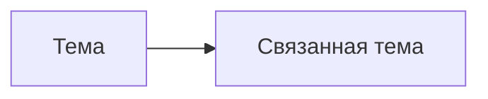

# День N. Название

> [!abstract] Зачем это слесарю-сборщику
> 1–2 предложения простыми словами.

## 🗺 Карта урока

## 🧩 Главное за 1 минуту
- 5–7 пунктов

## 🔍 Подробно
(аналогия → схема → таблица → шаги)

## 🛠 На рабочем месте: что вижу, что делаю руками

## ⚠ Типичные ошибки новичка
> [!warning]
> ...

## 🔀 У вашего мотора может быть иначе

## 📷 Фото-задание

## ✅ Самопроверка
> [!question]- 1. Вопрос
> - [x] Правильный вариант
> - [ ] Неверный, но правдоподобный вариант
> - [ ] Неверный вариант
> - [ ] Неверный вариант
>
> Пояснение: почему правильно именно так.

## ❓ 3 вопроса наставнику

## 📚 Термины
[[Глоссарий/...]]

## ➡ Дальше
[[следующий урок]]
